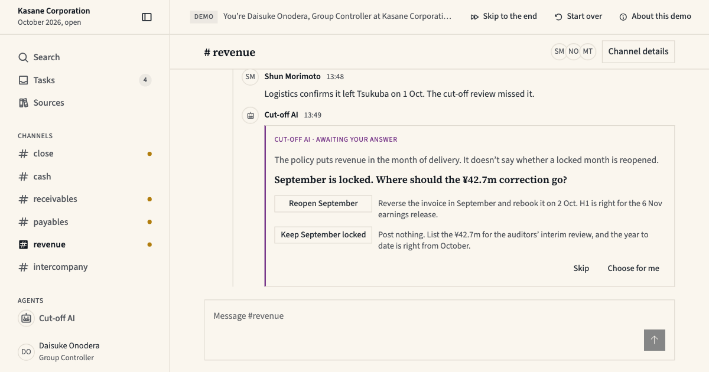

<h1>
  <picture>
    <source media="(prefers-color-scheme: dark)" srcset="brand/tabular-wordmark-dark.svg">
    
  </picture>
</h1>

React components for software where an AI agent does the work and a person signs it off: finance, data and operations tools. They show how the agent reasoned, what it proposes and what a person approved, and they come with the dense tables, run logs, metric tiles and lineage views those tools are made of.

[](https://demo.tabularui.com)

The demo is a finance workspace at Kasane, a fictional company. Here an agent stops and asks before it posts a correction.

**[Try the demo](https://demo.tabularui.com)** · **[Browse every component in Storybook](https://storybook.tabularui.com)** · **[Read the guide on tabularui.com](https://tabularui.com/getting-started)**

## Is it for you?

It fits if you:

- build screens where people review agent output: plans, tool calls, questions, confirmations, citations
- need dense data screens: 28px table rows, aligned figures, and status that never rests on colour alone
- use [shadcn/ui](https://ui.shadcn.com) with Tailwind CSS v4, or are starting a project that will

Look elsewhere if you:

- need a general-purpose kit for marketing pages or consumer apps
- aren't on React 19 and Tailwind CSS 4.1 or later
- want a versioned npm package: these components are copied into your app as source, and you own the copy

## What's in it

| Group        | Components                                                                           |
| ------------ | ------------------------------------------------------------------------------------ |
| Agent        | AgentBlock, AgentReasoning, AgentPlan, Confirmation, Question, Tool                  |
| Evidence     | Sources, InlineCitation                                                              |
| Chat         | ChatThread, ChatComposer, ChatStarter, ChannelMessage, PresenceStack                 |
| Data display | DataTable, MetricTile, RunLogRow, LineageTree, CodeView, AttachmentRow, TruncatedText |
| Status       | StatusBadge, StatusDot, ProgressBar, CountBadge                                      |
| Controls     | FilterChip, Toolbar, Field, ContextSwitcher, OrgSwitcher, ProjectSwitcher            |
| Shell        | AppShell, AppBar, AccountMenu, EmptyState                                            |

Those are the 34 product components. Under them are 18 foundational ones (Button, Input, Select, Dialog, Tabs and the rest) and one set of design tokens: the named colours, spacing and type sizes every component reads. Dark and light modes are both specified, and the five hues are used only to show state.

The full list, with what each component is for, is in [docs/components.md](docs/components.md).

Built with React 19, [Base UI](https://base-ui.com) primitives through shadcn/ui, Tailwind CSS v4 and OKLCH colour.

## Install

You need an app that is already a shadcn project: React 19, Tailwind CSS 4.1 or later, and a `components.json` from `shadcn init`. [shadcn's installation guide](https://ui.shadcn.com/docs/installation) covers that part.

Then add everything, or one component and what it needs:

```bash
pnpm dlx shadcn@latest add https://tabularui.com/r/all.json
pnpm dlx shadcn@latest add https://tabularui.com/r/button.json
```

Two setup steps follow, and the components don't look right without them: import the tokens in your stylesheet, and set the colour mode and tooltip provider at the app's root. Both are in the [package README](packages/ui/README.md).

After that, a component is an import:

```tsx
import { AgentBlock, Button, StatusBadge } from '@/components/tabular-ui';

<Button>Run models</Button>
<StatusBadge status="failed" />
<AgentBlock authorship="AI · Awaiting review">Two models changed since the last run.</AgentBlock>
```

## Status

A personal project with one maintainer, changing often.

- **No versioned releases.** The registry is rebuilt from `main` on every deploy. What you copied stays as it is until you add it again. Version 0.1.0 on npm is an early snapshot and isn't updated.
- **Tested in both modes.** Every Storybook story is rendered in dark and in light with an axe accessibility check, and a violation fails the test.

## Learn more

- [docs/design-system.md](docs/design-system.md): the spec, with the rules, the measured values and the reasons
- [docs/agent-voice.md](docs/agent-voice.md): how the agent's own copy is written
- [CONTRIBUTING.md](CONTRIBUTING.md): how to set up the repository and propose a change

## License

[MIT](https://github.com/pascochen/tabular-ui/blob/main/LICENSE) © Pascal Chenier

Use it in personal and commercial work, change it, ship it, sell what you build with it. Keep the copyright and license notice with any copy of the code. Provided as-is: no warranty, and no liability for the author.

This is a summary. The [LICENSE](https://github.com/pascochen/tabular-ui/blob/main/LICENSE) file is the legal text.
