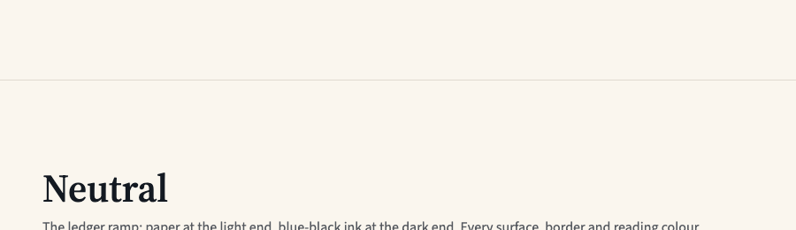
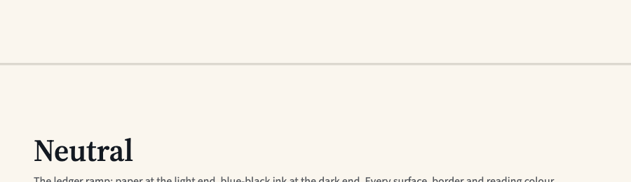
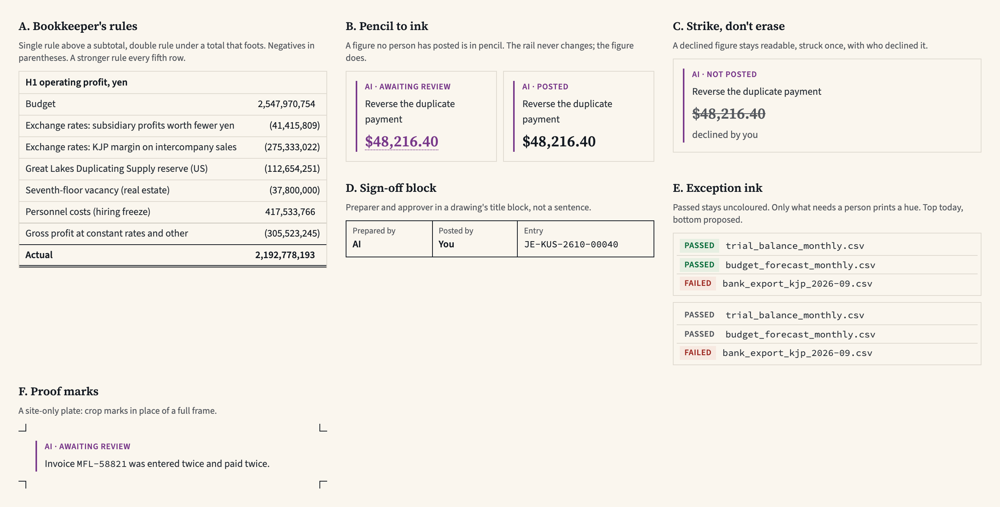
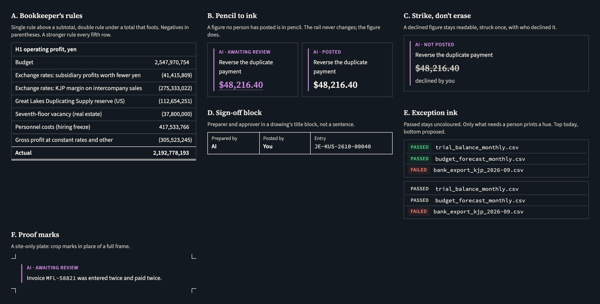

# Site spec v3.3 and art direction: review, 2026-11-02

Two parts, using methods from Ileana Marcut's UX + AI method library. Her AI product principles are the standing quality bar.

1. **Site spec v3.3.** Spec check-up and Regression guard, on `site-v3.3.md` and `site-spec-v3.3.diff`, read against `main` at `10a65ff`.
2. **Art direction.** Analogous inspiration, Divergent concepts, Constraint reframe, Concept stress test and Prioritize what to build.

**Status, 2026-11-02:** the owner approved the port. v3.3's decisions 16 to 19 are in `docs/site.md` as D10 to D13, not built yet (§13, step 6). The owner then took this review's recommendation on D11, so the double rule stays rare and section rules stay 1px: the live D11 replaces the version in "Refined spec" below. D10's list of site-only components stays open. Part 2 hasn't been decided.

Line references to `docs/site.md` are to that commit, before the port moved them. Measurements are from the live tabularui.com in Chromium 1248. Nothing in the repo has changed except this file and its images. The mock-ups are throwaways, not components. The art direction concepts are hypotheses: no finance user has seen them.

---

# Part 1. Site spec v3.3

## Verdict

**Don't apply v3.3 as it stands.** It's built on an old copy of the spec. The four new decisions (16 to 19) are worth keeping, but they need porting onto the live `docs/site.md`, and two of them need changes first.

## Spec check-up

### 1. Review summary, worst first

**1. The diff has no base in this repo.** `git apply --check` fails at line 1. Its context line, `# tabularui.com site spec (v3.2)`, has never been in `docs/site.md` (`git log -S` finds nothing). The diff does match the v3.3 file: it reverses cleanly against it. The live spec is 615 lines and v3.3 is 165, so copying the file over would delete D1 to D9, A1 to A5, §11 to §13 and the as-built record.

**2. v3.3 would undo a dozen shipped decisions.** Anyone building from it would rebuild what the owner already removed.

| v3.3 says | Live spec and site say | Live reference |
|---|---|---|
| 10 of 15 built, 5 shown as "Not built yet" | All 15 built since 2026-10-28 | `docs/site.md:61`, `:222` |
| `/components` index with filter chips | 307 redirect; filter removed 2026-10-27 | `:247`, `:276` |
| Home has outline links, principle cards and a moments row | Hero, component grid, closing band | `:272` |
| Nav is translucent with blur, Demo is the primary button | Solid, scrolls away; Get started on the right, Demo left the bar | `:167`, `:265` |
| Footer has a byline to pascalchenier.com and a version and changelog row | About column; the row was removed | `:265` |
| Foundations: Color, Typography, Depth, Constants | Color, Typography, Density | `:173`, `:175` |
| Getting started covers npm and the registry | Registry only; no npm releases | `:321` |
| Moment bands and the Vocabulary Use column on the raised surface | No band is tinted; Use column not tinted | `:85`, `:298` |
| Plates on the raised surface | Paper in grids, dark on component pages | `:86` |
| Site may import `fixtures/kasane.ts` | Never: fixtures aren't in `dist` | `:350` |
| `--site-pad`, `--site-grid-gap` and `--site-rail-*` | `--site-pad-x`, `--site-gap`, `--site-w-*` | `:423` |
| Spacing caps "pending owner confirmation" | Settled and built (A3) | `:450` |

**3. Decision 18 can't be built as written, and shipping it would break navigation.** See the regression list, items 1 to 4. The live spec already moved Foundations from `Tabs` to links, twice, for stated reasons (`:259`, `:496`).

**4. "Hover is the raised surface" does nothing on this site.** In light mode `--tui-canvas`, `--tui-surface` and `--tui-surface-raised` are all `ledger-50` (`theme.css:302-304`). Measured on the live site, all three resolve to `oklch(0.975 0.012 85)`. The hover would change nothing. The same applies to every other "raised" instruction in v3.3. The library's hover is `--color-bg-hover`.

**5. Decision 17's meaning has nothing behind it yet.** The diff says the rule "echoes a library behaviour", but `DataTable` has no totals row, no `tfoot` and no footer support. There is no such behaviour to echo. The "to check" in the library table is answered: it doesn't exist.

**6. Decision 16 contradicts §6 and the live site.** §6 is headed "Site components (in `apps/site`, never in `packages/ui`)" and lists `SpecimenFrame`, `ComparisonPair` and `PrincipleCard`. Decision 16 says anything that looks like a component ships in the library first. The live site also builds `CopyCommand`, the Foundations links and the component list itself. "Page structure" needs an exact list, or every one of these becomes a defect.

**7. Done-means items fail on day one.**
- Item 3, "no middle dots", with decision 7's "component props that render text are site copy", catches "AI · Posted" and the other authorship labels, which D1 and `docs/agent-voice.md` define (`specimens.tsx:124`, `:288`).
- "No eyebrows" catches the "Foundations" label above each Foundations title, which the owner chose on 2026-10-27 (`:259`).

**8. Dangling references.**
- "The build prompt" appears in §3 and in done-means item 8; the live spec says it is retired (`:5`).
- "Milestone 4" doesn't exist; the live order of work is steps.
- The Kagaku moodboard isn't in the repo, so its claims can't be checked here.

**9. A new line names things that don't exist.** "Amber means Unsure": `amber` was replaced by `ochre` on 2026-10-16, and "Unsure" appears in no component, in `agent-voice.md` or on the site. The word to use is the warning role, "needs review".

**10. Stale status.** The source highlight row says it "ships with" Inline citation and Sources. Both shipped on 2026-10-28 with no highlight.

**Checked and fine.**
- **`3px double` is crisp.** See the table below. The spec's construction works, and two stacked 1px borders are no better.
- **Decision 19, no highlight behind copy,** matches the live spec and rule 1. Port it as written.
- **Selected as ink** is allowed: §1 lists the active tab under the ink accent.

| Real device pixel ratio | `3px double` in device pixels (line, gap, line) | Reads |
|---|---|---|
| 1 | 1, 1, 1 | Crisp |
| 1.25 | 1, 1, 1 | Crisp |
| 1.5 | 1, 2, 1 | Crisp, wider gap |
| 1.75 | 2, 1, 2 | Crisp, heavier than a neighbouring 1px rule |
| 2 | 2, 2, 2 | Crisp |

A trap for the test: my first run used Playwright's emulated `deviceScaleFactor` and showed soft lines at 1.25, 1.5 and 1.75. That was the emulation. Re-measured with `--force-device-scale-factor`, every ratio is crisp. A test for done-means item 9 has to launch that way. Safari and Firefox are not measured.

**Crisp isn't the same as visible.** At 1.29:1, `--color-border` at 1x reads as one pale, slightly fuzzy line, not two (`rule-double-border.png`). `--color-border-strong`, at 1.62:1, just resolves into two (`rule-double-strong.png`). Only ink is unmistakable, as panel A of the mock-up shows. That answers the spec's pending question: the strong token, if the rule stays.

| Single, `--color-border` | Double, `--color-border` | Double, `--color-border-strong` |
|---|---|---|
|  |  |  |

### 2. Refined spec

Only what should change in the live `docs/site.md`, written to build from. All four decisions are kept. Text in brackets needs an owner answer.

```markdown
**D10. Library first — decided 2026-11-02 (owner).** A pattern a product could
reuse ships in `packages/ui` first, as its own decision and PR. Site-only, and
staying in `apps/site`: Rail, Section, SectionHeader, SpecimenFrame, Pair,
ComponentCard, the nav, the footer, FoundationsHeader, the component list,
CopyCommand, DemoAction. A new site component is added to this list by name, or
moved to the library. A library component is never restyled in `apps/site`.
[Owner: confirm the list.]

**D11. Section rules are double rules — decided 2026-11-02 (owner).** A direct
child of `<main>` other than the first takes
`border-top: 3px double var(--color-border-strong)`. The closing band has no
rule: its change of ground separates it. Moments on Home keep their 1px rule,
and so does the footer, which is outside `<main>`. Nothing sits beside the rule.
§7.8 of the design system gains a line for it first, because §7 of this spec
says borders come from the library. Replaces D3 item 1's "1px" and §7's rhythm
line. The hero's sheet keeps `--color-border`, and its comment "the section
rules' colour" is corrected. [Owner: see the recommendation below.]

**D12. Foundations' links look bordered — decided 2026-11-02 (owner).** They stay
real `<a>` elements in a `<nav>`, one per route, with `aria-current="page"`.
`packages/ui` exports the appearance as a cva (`tabVariants`), used by a new
`bordered` variant of `TabsList` and by these links. Borders are
`--color-border` on every side, with neighbours sharing one line. Hover is
`--color-bg-hover`. Selected is `--color-fill-interactive` with
`--color-on-interactive`, and its hover is `--color-bg-hover-inverse`. Focus is
the library's ring, inset. In forced colours the selected item keeps a visible
mark other than its fill. Labels are sans SemiBold in sentence case at
`text-site-body`, which needs a `size` on the cva: at the library's 13px beside
a 64px title, most visitors missed these links (2026-10-27). Replaces the 2px
underline in §3.

**D13. No highlight behind site copy — decided 2026-11-02 (owner).** Every hue
already has a role, so a highlighter would borrow one. Emphasis is weight, or
nothing. A text highlight may exist later as the source mark in Inline citation
or Sources, which shipped without one; on the site it then appears only inside
their specimens. Not designed yet.
```

Add to §11 and §13:
- `Section` draws the rule in the token above, checked by computed style.
- The double rule is checked for two separate lines at real device pixel ratios of 1, 1.5 and 2.
- The bordered links pass the forced-colours check.
- Every Foundations link is an `<a>` in the HTML before hydration.

Drop from v3.3: everything in Decisions 1 to 15 and §2 to §10 that the live spec has moved past, since the live spec is the record of those.

**My recommendation on D11: keep the double rule rare.** §7.8 says a border treatment "is only informative while it is rare". Today's page structure would spend it like this, counted on the live site:

| Page | Double rules |
|---|---|
| Home | 1 (the 5 moments stay single) |
| Component pages | 0 |
| Getting started | 1 |
| Vocabulary | 3 |
| Color, Principles | 4 |
| Typography | 5 |
| Density | 6 |

So it would appear most on reference pages with no totals on them, and never on the pages visitors spend time on. To a finance reader a double rule means "this total is final". Used as a divider it says nothing, and it would dilute the mark before the table can use it. Instead, build it into `DataTable` first and use it on the site once, where something really closes: under the bridge on Lineage tree's page, or at the end of a page. This is the owner's call. The spec above is written either way.

## Regression guard

### 1. Before: the risk list

| # | Change | What depends on it | What could break | Verify |
|---|---|---|---|---|
| 1 | Foundations uses library `Tabs` | `TabsTrigger` hardcodes `<button>` and omits `render` (`Tabs/index.tsx:62-68`) | Routes can't be links without changing a foundational part. **[Ask first, per `CLAUDE.md`]** | Decide per D12 |
| 2 | Same | Deferred hydration: "every link works before hydration; what waits is the buttons" (`site.md:605`) | Foundations navigation is dead until hydration, about 2.8s on a throttled phone, and permanently without JavaScript. Crawlers lose the links between the three pages | HTML before hydration has `<a href>` |
| 3 | Same | `role="tab"` semantics; "tabs switch a view, a nav changes the page" (`:259`) | A screen reader announces tabs and then a full page load. `aria-current`, the owner's VoiceOver pass and `pages.spec.ts:462` onward all need redoing | Re-run `docs/site-voiceover.md` |
| 4 | Library type size in the tabs | 2026-10-27 critique: 13px links beside a 64px title were missed (`:259`) | Brings back the finding that option A fixed; "never restyle" blocks the local fix | Size variant on the cva |
| 5 | `bordered` variant | `tabsListVariants`, `::after` indicator scoped to `line`, 2px rule in §7.8 | Line and segmented baselines must not move. Shared borders need `-ml-px` and a raised z-index on focus, or the ring is covered | `tests/tabs.spec.ts`, Tabs stories, both modes |
| 6 | Same | Registry and shadcn copies, `docs/components.md`, the Tabs README | Consumers get the variant only on re-add; the inventory goes stale | Registry build, README, stories |
| 7 | Selected as ink fill | Forced-colours check: filled controls keep a border (`quality.spec.ts:402`) | Forced colours remove the fill, so the current page looks like the others | Check on `/foundations/color` |
| 8 | Hover via raised | `theme.css:302-304` | No visible hover in light mode | Use `--color-bg-hover` |
| 9 | `3px double` on `Section` | `layout.tsx:52` and every page using it | Adds 2px per band. No visual baselines cover the site, so nothing fails if it looks wrong | Screenshots at 1440 and 390 |
| 10 | Same | `site.md:409` says all borders come from library tokens; the Density page renders §7.8, "1px everything" | The Density page would state a rule the page itself breaks | §7.8 line first |
| 11 | Same | The comment in `apps/site/src/index.css`; D3's sheet colour | Hero sheet and section rule stop matching; the comment goes stale | Update both |
| 12 | Section tone `raised` | D3; `theme.css` | Invisible bands; the argument for them doesn't reach the screen | Remove from the port |
| 13 | Decision 7, props are site copy | `AgentBlock.authorship`, `docs/agent-voice.md`, approved copy | Rewriting "AI · Posted" would change library strings and the Storybook, across the approved copy | Keep library strings out of scope [assumed: owner meant site-authored copy] |
| 14 | Porting v3.3's data rule | `tools.md` package rules; `apps/site/data/kasane.json` | A site import of `fixtures/` fails, since they aren't in `dist` | Don't port |

### 2. After the change: the re-test list

There's no code diff yet, so this is the list to run once D10 to D13 are built.
- `pnpm lint`, `pnpm typecheck`, and the site's Playwright suite, especially forced colours, no client-side links, and link names.
- Story tests and visual regression for `Tabs` in both modes; `line` and `segmented` must show zero changes.
- `pnpm --filter tabular-ui contrast`, and `docs/design-system.md` §10's checklist, since this is a UI PR.
- Axe at 1440 and 390, before and after hydration, on the three Foundations pages.
- The VoiceOver script on Color.
- Lighthouse, with versions written down: the bordered links must not add a module to first paint.
- Anything outside scope: confirm the diff touches only `Tabs`, its variants, its docs, `apps/site`, §7.8 and `docs/site.md`.

---

# Part 2. Art direction: strengthening the personality

**The problem, as I've framed it.** Tabular's art direction is unusually specific in its documents (a mid-century Japanese ledger printed in spot inks) and much less specific on screen. Correct me if the goal is different.

**Hard constraints, from `CLAUDE.md`.** Colour means state. Five hues, no sixth. Square corners. Density caps. Agent authorship stays orchid on a rail. The brand marks are off limits as a source.

**What I saw on the live site, 1440 wide.**
- **What has character:** the wordmark, the serif headings, the ruled hero, the dark plates and the overlay's second sheet.
- **What doesn't:** the middle of Home. Fifteen thin-framed boxes on paper could belong to any tasteful component library. The hero's ruling is the one thing that says "ledger", and it stops there.
- **The gap:** nothing in the library behaves like a ledger. Figures take a hyphen for a negative (`format.ts:22`), tables have no totals, and text selection is the browser's default blue, off-palette on a site about colour discipline (no `::selection` in the package).

**The finding that drives the rest.** Personality here shouldn't be added as decoration, because rule 1 forbids it and the audience distrusts it. Bookkeeping has centuries of marks that are already about state: who wrote this, is it final, does it add up. Those fit the rule, and they are what no other design system has.

## Analogous inspiration

**The abstract job.** In a dense record that experts scan for hours, show at a glance what is provisional, who made each mark, and what has been finally accepted, without erasing history.

| Field | The pattern | Why it's the same job | How to adapt it |
|---|---|---|---|
| Laboratory notebooks | Errors are never erased: one line through, so the original stays readable, with initials and a date | The record has to prove what was believed and when, so correcting can't mean destroying | A declined or reversed figure stays visible, struck once, with who did it. Panel C |
| Engineering and architectural drawings | A title block with drawn, checked and approved initials, and revision marks on what changed | Several people stand behind one artefact, and a reader must see who without reading a paragraph | Preparer and approver as a small fixed block, in place of `meta` "posted by you". Panel D |
| Air traffic control's paper flight strips | A strip that needs attention is physically offset in its rack | Scanning a dense column for the one item needing action, in a job where colour alone is unsafe | A row waiting on a person shifts by a fixed step. Shape carries it in grayscale and for deuteranopes, where the palette is weakest (§1) |
| Proofreading | A small fixed set of marks in the margin, proposing changes the author accepts or rejects. The text underneath stays untouched until then | One party proposes, another decides, and the proposal must not read as already done | The agent writes beside the figure, never over it. Concept 10 |
| Annotated chess scores | Tiny glyphs next to a move, such as `!` and `?!`, give a verdict without interrupting the record | Compressed judgement beside dense notation, read by experts | A fixed glyph for how sure the agent is, beside a figure, under AI principle 3. It must come from a signal the agent really has |

## Divergent concepts

Ordered from conventional to strange. Not ranked here. Each is an unvalidated idea.

| # | Axis | Concept | Who it's for | Main risk |
|---|---|---|---|---|
| 1 | The data's own marks | **Bookkeeper's rules.** Single rule above a subtotal, double under a total that foots, parentheses for negatives, a stronger rule every fifth row | Controllers and FP&A reading long tables | Bare parentheses read poorly to non-finance users of the library |
| 2 | Hierarchy | **Figure first.** On any surface the largest thing is a number in the serif, and headings step down around it | People checking one number | Fights density on screens with many figures |
| 3 | The site's frame | **Proof sheet.** Plates carry crop marks in place of a full frame, as a printer's proof would. Kasane is a printer maker, so it's in the world already | Designers visiting the site | A costume: a reference with no meaning for a finance reader |
| 4 | Amount of colour | **Exception ink.** Passed goes uncoloured. Only what needs a person prints a hue, so a clean run has no colour at all | Anyone scanning for trouble | Green is what people look for to feel safe; every baseline moves |
| 5 | Who is visible | **Sign-off block.** Preparer and approver in a fixed, drawing-style title block, wherever an entry appears | Reviewers and auditors | Reads as bureaucracy in a chat turn |
| 6 | A number over time | **Pencil to ink.** A figure no person has posted is in pencil; posting inks it. The rail stays, because authorship doesn't wash off (D2) | The person deciding | Dotted orchid looks like a link. Visible in panel B |
| 7 | Typeface as author | **The person signs in serif.** Machine text stays sans; a person's decision ("Posted by you") is set in the serif | Anyone reading a long thread | Breaks "only a heading goes serif" (§8.3) and adds an exception to a clean rule |
| 8 | Container, breaks "dashboard" | **The book.** The home screen isn't a dashboard. It's the open period's page, which closes with a double rule and turns | Teams who work in monthly closes | Throws away the familiar layout; only fits close-shaped work |
| 9 | Output, breaks "shows more" | **The working paper.** Every run prints to one sheet, with no chrome: figures, sources, sign-off. If it fails on paper in one ink, it fails | Auditors, and anyone who has to send evidence on | Print is real engineering, for a small share of sessions |
| 10 | Initiative, breaks "waits to be asked" | **The margin.** The agent annotates beside figures unprompted, and never touches the figure itself | Reviewers facing a big file | Noise; goes against AI principle 13 unless it's quiet and easy to turn off |

## Constraint reframe

| Constraint | Concept | How it still solves the problem |
|---|---|---|
| **No screen at all** | **One sheet of paper.** Define what an agent run looks like printed in one ink, then treat that as the test of the art direction | If authorship, state and sign-off survive with no colour, the personality is structural. It extends §10's grayscale check from a pass or fail to a design goal |
| **A first-timer gets it in 10 seconds** | **One figure, two states.** The hero shows one amount in pencil, then the person posts and it inks | Teaches the whole trust story with one mark, in one glance. It needs no vocabulary, and works in a still frame, which matters for D6's teaser |
| **The AI acts fully on its own** | **The morning sheet.** Overnight the agent works through the close and leaves a page where everything is in pencil and nothing is inked | Takes the premise and keeps the principle: it did all the work and decided nothing. A person arrives to a page of proposals, and AI principles 2 and 13 still hold |

## The mock-up

Real tokens and fonts, real Kasane figures from `apps/site/data/kasane.json`, checked to foot in the script. Light, then dark.





Reading them honestly:
- **A is the strongest.** Instantly finance, and the double rule in ink is what the site rule was reaching for.
- **B works as a state, but looks like a link.** It needs a different mark before it could ship.
- **C is good, but struck serif at this size is heavy.** Try a thinner line, or the figure in sans.
- **D is too heavy in ink.** `--color-border-strong` would be closer.
- **E is calm and clear.** The cost is everywhere else, not on screen here.
- **F looks nice and means nothing.** That's the argument against it.

## Concept stress test

**The concept: Ledger marks.** Four marks in the library, which between them cover the trust story. A, a single rule over a subtotal and a double rule under a total that foots, plus parentheses for negatives. B, pencil until posted. C, strike and don't erase. D, a sign-off block.

**A skeptical user**
- "Orchid dotted figures look like links. I'll click `$48,216.40` and nothing will happen."
- "Parentheses are fine for me, but my ops colleague reads `(41,415,809)` as a note."
- "If a declined figure stays on screen struck through, I'll misread it as live when I'm moving fast, and it's the same size as a real one."
- "The block says Prepared by AI. Prepared from what? I still have to open Sources."

**An engineer**
- "`DataTable` virtualizes and filters. Is the total over all rows or the filtered ones? A double rule under a filtered subset is wrong in a way nobody notices."
- "Who decides that it foots? `DataTable` doesn't know which column adds up, or what the parts are. That's a new prop, and a prop can lie."
- "Shipped by registry, these marks copy into apps I can't update, so a wrong rule stays wrong there."
- "A row's height budget is 28px. A `3px double` on the last row adds 2px, and a virtualizer that estimates 28 drifts, which is already in the failure log."
- "Orchid on figures takes it past the rail and the label. Under deuteranopia info and agent are about 3 apart, and `running` sits nearby."

**An exec**
- "Testers on 2026-11-02 didn't see the demo's decision buttons at all. Why is a dotted underline next?"
- "The demo still says 'soon' on the site. Does a double rule get anyone to install a component?"
- "Marks only finance people recognise may narrow a library you describe as for designers and engineers. Which audience is this for?"

**The most fatal objection: a mark that states a fact is a claim, and the library can't check it.**

A double rule tells an accountant the total is final and adds up. If a caller can draw it with a prop, the library will one day put a false assurance under a wrong number, in the product whose second principle is that every number opens down to the entry behind it. `MetricTile`'s down arrow is the same failure at small scale, and the failure log's lesson is direct: "A fallback that states a fact is a guess." That applies to the pencil and the sign-off too.

So the marks have to be derived, never styled. The double rule draws only when the displayed parts sum to the displayed total, computed in the component, and otherwise a single rule shows. The site's D5 already has a test for this idea. It's also the deepest reason to keep the mark off section dividers: it can only mean something if it is never decoration.

## Prioritize what to build

**Goal, as I've assumed it:** make Tabular recognisable in one screen to a finance-literate reader, without breaking a rule, with one owner working on it. **All ratings are my estimates for you to confirm, not data.** No finance user has seen any of this yet.

| Quadrant | Item | Impact | Effort | Why here |
|---|---|---|---|---|
| **Quick wins** | Minus sign and negatives in `format.ts` and `DataTable` stories | Medium | Low | A hyphen for a negative is the wrong character in a finance tool. Parentheses as an option on top |
| | `::selection` from the palette | Medium | Low | People copy IDs here constantly, and today that paints off-palette blue. Needs a spec line and a contrast run |
| | Strike, don't erase, on "AI · Not posted" | Medium | Low | The declined state already exists. AI principle 5 |
| | Stronger rule every fifth row | Medium | Low | Helps eye tracking too. By row index, so it survives sorting |
| **Big bets** | `DataTable` totals row with derived single and double rules | High | Medium | The signature mark, and the base for D11's meaning. Height belongs on the cell. Decide total-of-what with filters |
| | Sign-off block as a product component | High | Medium | Makes D2's preparer and approver visible. Product layer, so no permission needed |
| | Pencil to ink | High | Medium to high | The most distinctive idea, and the riskiest. Needs a mark that doesn't read as a link, and a side-by-side |
| | One-ink working paper | Medium to high | High | Later: the proof of the whole direction |
| **Fill-ins** | Proof marks on site plates | Low | Low | Pleasant, and no meaning |
| | Offset row for "waiting on a person" | Medium | Low to medium | Try it with the fifth-row rule; it might fight the agent rail's 2px |
| **Time-sinks, for now** | Exception ink | Medium | High | Moves every status and baseline. Test on one screen first |
| | The book, replacing the dashboard | Unknown | High | Rethinks the product. Not an art direction change |

Flagged as bundled and split above: "bookkeeper's rules" was four items.

**The order:**
1. **Start with the minus sign,** today: it's small, it's plainly correct, and it costs nothing to review.
2. `::selection`, then strike.
3. Then `DataTable` totals with the derived rule. That's the one to design carefully, because the site's double rule can then point at something real.
4. Sign-off block.
5. Pencil to ink, once you've shown a side-by-side to three to five people who do closes, and it isn't read as a link.

## Conclusion

- **v3.3 shouldn't be applied.** It's based on an older copy of the spec and would undo a dozen shipped decisions.
- **Decisions 16 to 19 are worth porting** as D10 to D13. The refined text is in Part 1.
- **Bordered tabs:** the look is fine, but they have to stay links, or Foundations navigation stops working before hydration.
- **"Hover is the raised surface" does nothing in light mode.** Use `--color-bg-hover`.
- **`3px double` renders crisply.** The issue is meaning and visibility: at 1.29:1 it reads as one faint line, and using it as a divider spends the mark.
- **The personality gap is in the library, not on the site's surface.** Nothing behaves like a ledger yet.
- **The direction to pursue is Ledger marks:** marks that bookkeeping already uses for state, which fit rule 1 and which no other system has.
- **Every mark must be derived from a check, never set by a prop.** That was the fatal objection, and it's what makes the idea trustworthy.
- **Everything in Part 2 is untested.** The mock-ups need finance users before any of it is treated as decided.
