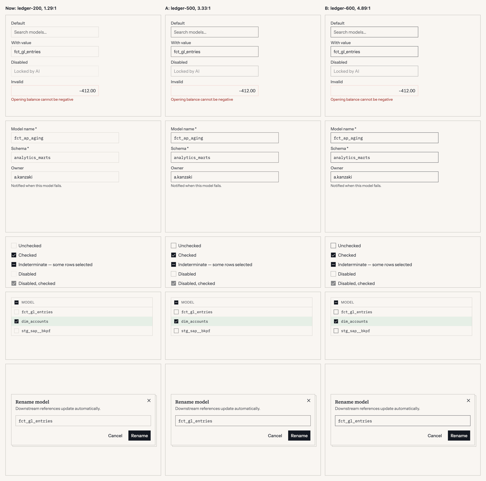
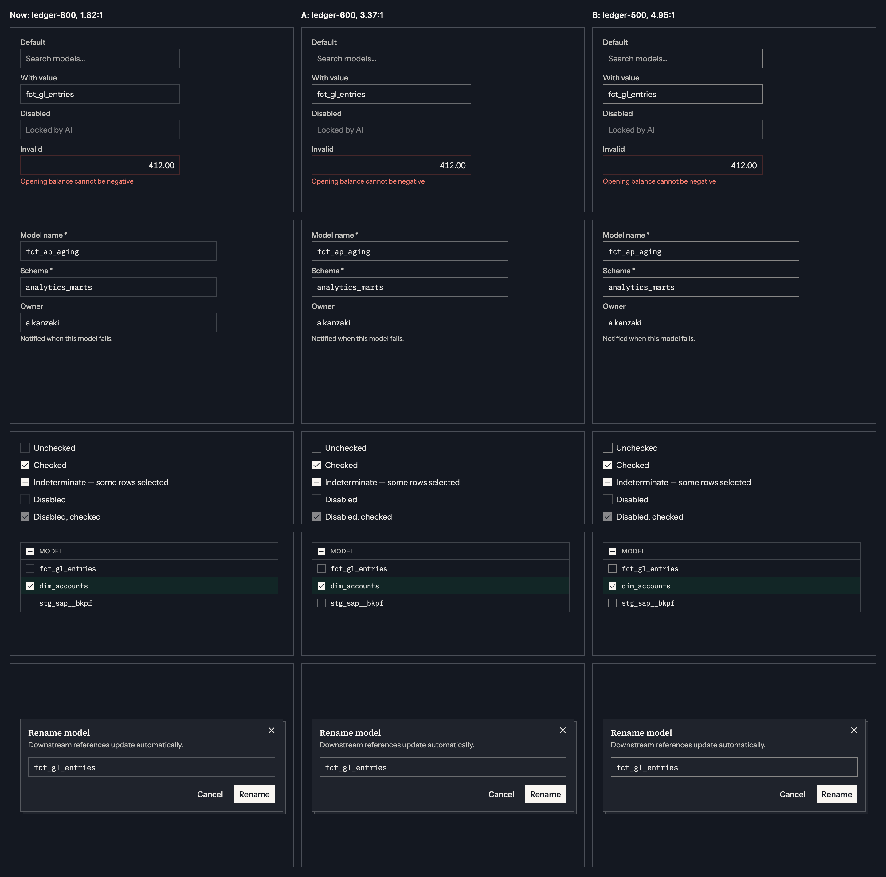

# Control boundaries are under 3:1: proposal, 2026-11-10

**Status, 2026-11-10:** the owner chose option B the same day, which takes decisions 1 and 2. They are applied: `docs/design-system.md` §3 and §4 "Control edge", `--color-border-control` in `theme.css`, the five foundational controls and `ChatComposer`, and the gate in `check-contrast.mjs`. Decision 3, the invalid edge, was approved the same day and is applied to `Input`, `Textarea`, `Select`, `Checkbox` and `Switch`. The text below is the proposal as written.

**Asked of the owner:** three decisions.

1. **Add one token, `--color-border-control`,** for the edge of a form control. Recommended.
2. **Its value: option A or option B** below. I recommend B, and the side-by-side should decide.
3. **An invalid control's border becomes solid `--color-text-danger`.** Recommended, and separable.

## What this touches

Listed first, as the failure log asks of any token proposal.

| Where | What it says today | Effect |
|---|---|---|
| `CLAUDE.md`, "You must ask before: adding a new token of any kind" | | This is the ask |
| §3, both neutral tables | Two borders: `--color-border` and `--color-border-strong` | A third row, in both modes |
| §4, naming pattern | `--color-border-{role}`, with neutral tokens in the same namespace | `control` is not a role. It joins the neutral names, as `strong` does |
| §4, "Three states deliberately have no new token" | Lists hover border on a chip as `--color-border-strong` | Unchanged. This is not a state token |
| Failure log, "Invented `--color-bg-selected`" | A token that duplicates another at a near-identical value is a defect | Checked: neither option's value is an existing border token's in either mode |
| Failure log, "`--color-border` for a divider inside a popup" | `popupSurface` redefines `--tui-border` as `--tui-border-strong` for its subtree | A control in a popup would stop depending on that override, under option B |
| §0 rule 7, "Borders do the work whitespace does" | 1px `--color-border` separators | Unchanged. Dividers, cards and table rules keep `--color-border` |
| §5, agent rail | Moved from the `--color-border-agent` tint to solid `--color-text-agent`, because the tint measured 1.3:1 | Decision 3 is the same move, for the same reason |
| `check-contrast.mjs` | Reports `border` and `border-strong`, gates neither | The new token would be gated at 3:1 |

No hue is added. No existing token changes value or name.

## The problem

`PRODUCT.md` sets the target at WCAG 2.2 AA. Success criterion 1.4.11 asks 3:1 for the visual information needed to identify a control.

`Input`, `Textarea`, `Select`'s trigger, `Combobox` and an unchecked `Checkbox` are drawn by `--color-border` alone, on a transparent ground: 1.29:1 on paper and 1.82:1 on the dark canvas (§3's own figures). The spec measures every text token on every ground and gates it. It reports the borders and gates neither.

An unchecked checkbox is the firm case. It has no label inside it, no placeholder and no fill, so the 1.29:1 square is the whole control. In `DataTable`'s row-selection column, on a hovered row, it measures 1.15:1.

An input is the softer case: a visible label and a placeholder are other cues, and some auditors pass a faint field border on that basis. The images show what is lost either way. In light mode an empty form reads as a column of labels.

A second finding, from the same measurement. **An invalid control's border is the faintest of all.** `--color-border-danger` is a 20% or 25% tint: 1.27:1 on paper, 1.34:1 on the dark canvas. The error is carried by the message under the field, so nothing is unreadable, but the field itself looks less present than its valid neighbours. Any fix to the default border makes that inversion worse.

## Measured

WCAG 2.1 contrast, from the hex values in `docs/palette.json`, tints composited in sRGB. "Hover" is `--color-bg-hover` over the ground. "Selected" is `--color-bg-interactive` over the canvas.

**Light mode.** Canvas, surface and raised are all paper.

| Step | Canvas | Hovered row | Selected row | Selected, hovered |
|---|---|---|---|---|
| `ledger-200`, today | 1.29 | 1.15 | 1.19 | 1.06 |
| `ledger-300`, `--color-border-strong` | 1.62 | 1.44 | 1.48 | 1.32 |
| `ledger-400` | 2.23 | 1.98 | 2.04 | 1.82 |
| `ledger-500`, **option A** | 3.33 | 2.95 | 3.05 | 2.71 |
| `ledger-600`, **option B** | 4.89 | 4.34 | 4.49 | 3.99 |

**Dark mode.**

| Step | Canvas | Raised | Hovered row | Raised, hovered | Selected row | Selected, hovered |
|---|---|---|---|---|---|---|
| `ledger-800`, today | 1.82 | 1.61 | 1.56 | 1.36 | 1.61 | 1.36 |
| `ledger-700`, `--color-border-strong` | 2.49 | 2.21 | 2.14 | 1.86 | 2.21 | 1.87 |
| `ledger-600`, **option A** | 3.37 | 2.99 | 2.90 | 2.52 | 2.99 | 2.53 |
| `ledger-500`, **option B** | 4.95 | 4.39 | 4.26 | 3.70 | 4.40 | 3.72 |

## Decision 1: one token for a control's edge

`--color-border-control`, used by `Input`, `Textarea` (not `borderless`), `Select`'s trigger, `Combobox`'s input and chips container, an unchecked `Checkbox`, and `ChatComposer`'s box, which draws the border for the borderless `Textarea` inside it.

**Why a token and not a new value for `--color-border`.** `--color-border` also draws every divider, card edge and table rule. Raising it to 3:1 would turn the ruled-paper quiet of the whole interface into a grid of dark lines, and a divider is not a control: 1.4.11 does not ask 3:1 of it.

**Why not `--color-border-strong`.** It is 1.62:1 in light and 2.49:1 in dark. It would have to move too, and it draws every popup's edge and the overlay sheet.

**Left out, on purpose.**

- **`Button variant="outline"` and `Chip`.** Each is identified by its text label, which clears 4.5:1. Their border is the "this is pressable" signal §7.7 describes, not the control's only mark. A firmer edge on every outline button would also compete with the one solid primary action (§4, "Button groups").
- **`Switch`.** Its off state reads by its thumb, which is `--color-text-primary`.
- **Disabled controls.** WCAG exempts them, and `controlBase` fades them to 50% as a whole.

## Decision 2: the value

| | Light | Dark | Clears 3:1 on |
|---|---|---|---|
| **A** | `ledger-500` | `ledger-600` | The canvas only. Misses on a hovered or selected row in both modes, and on the raised surface in dark (2.99) |
| **B** | `ledger-600` | `ledger-500` | Every ground measured, 3.70:1 at worst |

**I recommend B.** The system's standard for text is "every ground it sits on", and a checkbox sits on hovered and selected rows by design. A token gated at 3:1 that fails on the grounds its main user lives on would need an exception list from day one.

**What B costs.**

- In light mode the edge is `ledger-600`, the value of `--color-text-tertiary`, which is also the placeholder. An empty field's border and its placeholder are then one colour. It reads as one object, which is arguably right, but it has not been looked at next to real content.
- In dark mode the edge is brighter than any other line on the screen, the focus ring aside. Forms get visibly firmer than the tables beside them.
- The focus ring must still read as a change on top of it. The ring is 2px `ledger-800` in light and `ledger-200` in dark, offset 1px, so it differs in weight, position and step. Not measured as a pair.

**What A costs.** It is the quieter look, and the unchecked checkbox in a hovered table row stays under 3:1.

A split, B for `Checkbox` and A for fields, would need two tokens. I'd avoid it.

## Decision 3: the invalid edge is solid

`aria-invalid` controls take `border-color: var(--color-text-danger)`: 7.15:1 on paper, 6.99:1 on the dark canvas. No new token, and `--color-border-danger` keeps its other uses.

This is §5's reasoning for the agent rail, applied to a field: a tint under 3:1 cannot be the mark that carries a state. It also keeps the order right once the default edge is firmer: default, then invalid, each stronger than the last.

The mocks below do not show this decision. Their invalid fields keep today's tint, which is why they look faint beside the firmer default edges.

## How to see it

Both images were made from the Storybook stories with one injected rule, no code change. Columns are today, A and B. Rows are `Input` States, `Field` FormStack, `Checkbox` States, `Checkbox` RowSelection and `Dialog` Open.





```css
[data-slot='input']:not([aria-invalid='true']),
[data-slot='textarea']:not([data-variant='borderless']):not([aria-invalid='true']),
[data-slot='select-trigger']:not([aria-invalid='true']),
[data-slot='combobox-input'],
[data-slot='combobox-chips'],
[data-slot='checkbox']:not([data-checked]):not([data-indeterminate]):not([aria-invalid='true']) {
  border-color: #888786 !important; /* ledger-500. #6a6c6f is ledger-600 */
}
```

**Not checked:** a hovered or focused control, `Select` and `Combobox` open, the demo and the site, grayscale, and any user. The figures are computed, not read from a browser.

## If approved

1. Write the token into §3's two tables and a short "Control edge" paragraph in §4, with these figures.
2. Transcribe `--tui-border-control` and `--color-border-control` into `theme.css` and log it in the header.
3. Point the five foundational controls and `ChatComposer` at it. This is the sign-off for the foundational edits too.
4. Gate it in `check-contrast.mjs` at 3:1 on every ground, and add the pair to `contrast.spec.ts`.
5. Decision 3, if taken: `aria-invalid:border-text-danger` on the same controls and on `Switch`.
6. Run §10's checklist. Nearly every story with a form control changes its screenshot: declare `Input`, `Textarea`, `Select`, `Combobox`, `Checkbox`, `Field`, `Dialog`, `Popover`, `DataTable`, `Question`, `ChatComposer` and `Tokens` before the first push, and check that list against a local run first.
