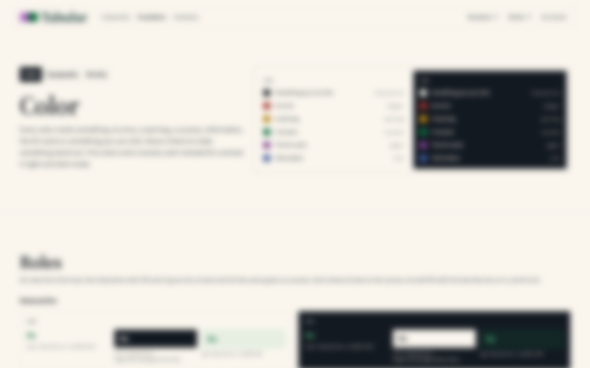
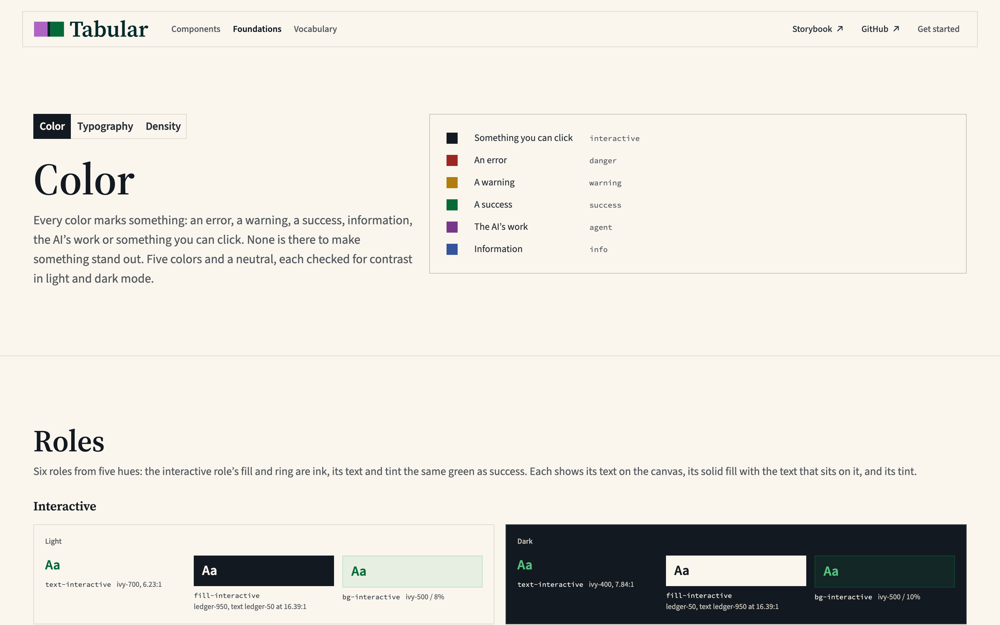
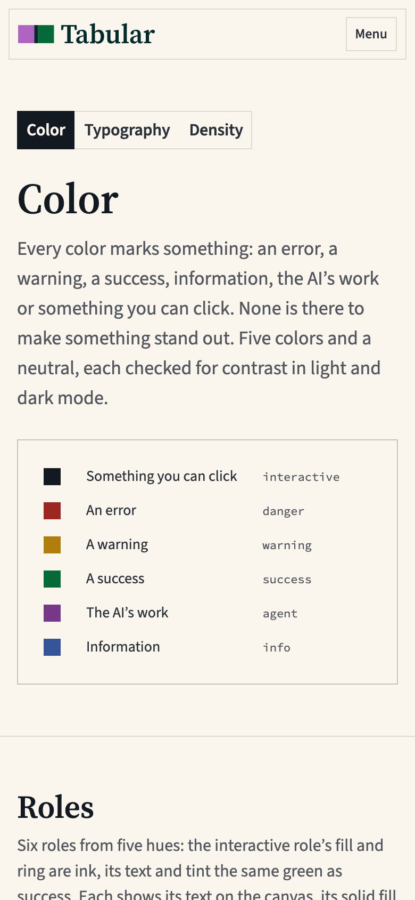
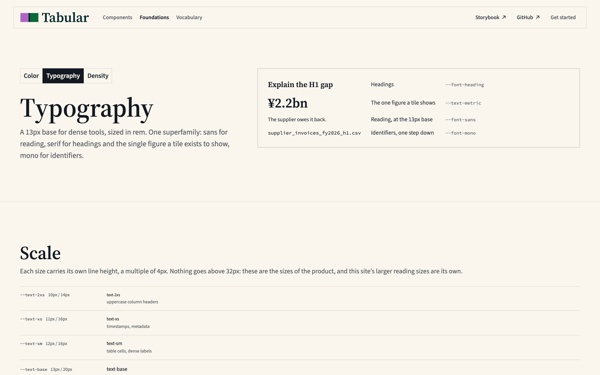
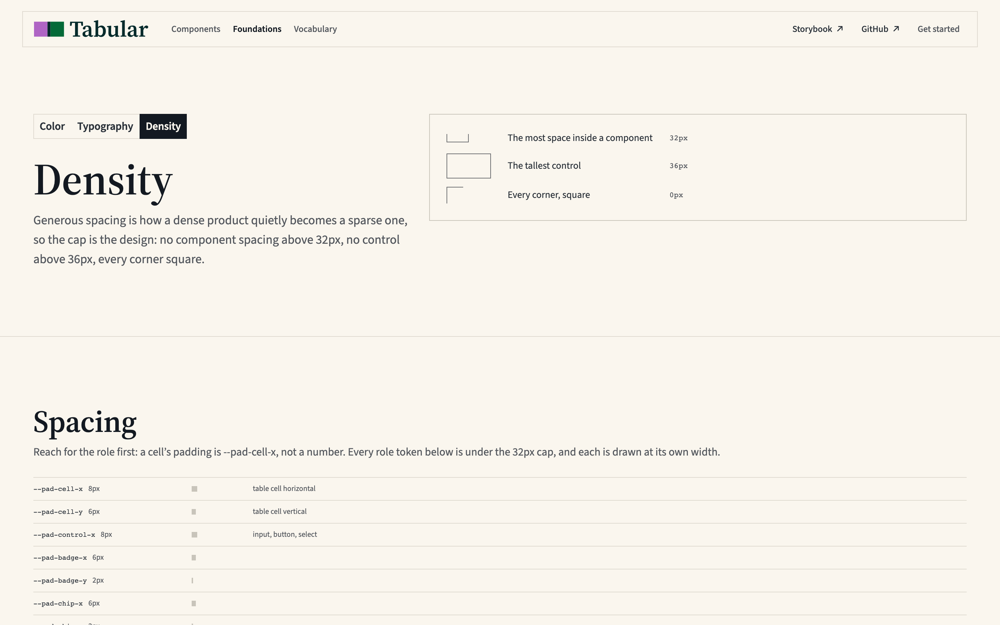
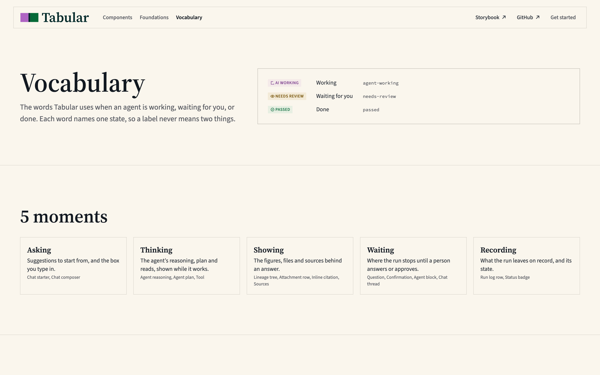
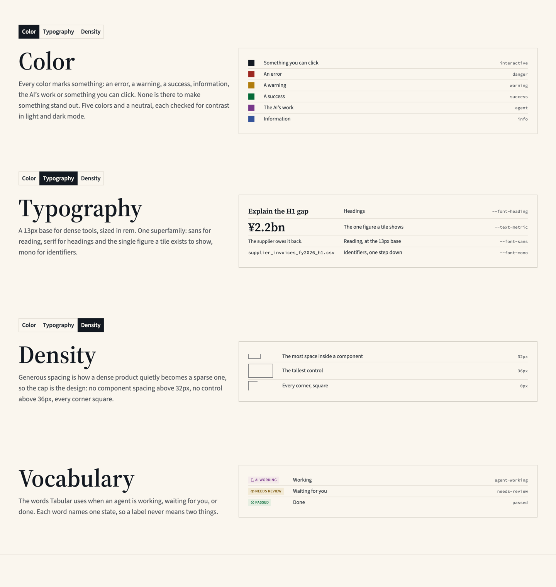
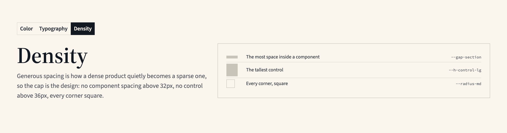
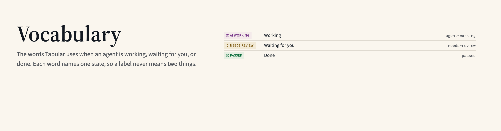

# Inner page heads: critique and alternatives, 2026-11-05

The owner's idea: give the opening band of the inner pages (Color, Vocabulary, Getting started and the rest) its own texture, different from Home's paper, to show that this is the top of the page and what the page is about.

Methods from Ileana Marcut's UX + AI method library: Concept stress test, Analogous inspiration and Variants of one element. Read against `docs/site.md` D3, `docs/reviews/art-direction-2026-11-02.md` and the live tabularui.com. Nothing in the code has changed. Every variant is a hypothesis: no visitor has seen any of them.

---

## What's on screen

- **Home's hero** is split 5/7. The title, lead and two buttons sit on the left, and a paper plate with the specimen sits on the right. Behind both is the ruled sheet on the paper grain, fading toward the edges.
- **An inner page head** (Color, at 2000px wide) has the Foundations links, the 64px serif title and the lead, all in the left half. The right half is empty paper. Then comes the full-width 1px rule.
- **Vocabulary** is the same without the links. **Getting started** is on the narrower reading rail. **A component page** has the title and its decision line, with the component list beside them.
- **The difference you notice isn't only texture.** Home's hero has something in its right columns. An inner head has nothing there, so it reads as unfinished. A texture would fill that empty half with grain. It wouldn't fill it with anything to read.

## Your idea, as I've read it

There are two readings, and the stress test covers both:
- **A.** One shared texture on every inner head, different from Home's.
- **B.** A texture per page, matched to its subject.

---

## Concept stress test

### A skeptical visitor

- "Color's lead says 'None is there to make something stand out.' The texture right under that sentence is there to make the head stand out."
- "I come from Home, which has grain and rules. On Color the grain is different. Two papers read as two sites, or as a mistake."
- (B) "Color is one texture and Density another. I'd have to learn a code across 23 pages, and I'll visit three of them."
- "The page already tells me it's the top. The title is 64px serif, and a full-width rule closes the band. What does the texture add that I'd notice?"

### An engineer

- **Each texture needs tuning by eye.** Home's paper was set by you, on one Retina screen, with live sliders. Every new texture repeats that work.
- **Each texture needs its own pixel checks.** `tests/paper.spec.ts` checks Home's paper on `/` only: the lead's contrast (6.64 → 6.47:1), the strongest mark at 1.05:1, an unchanged height and the forced-colours drop. Every new texture on every page needs all of those.
- **The current paper isn't fully verified yet.** It's still unchecked on a 1× monitor, in Safari and in Firefox (main review, 2026-11-04). More textures multiply that.
- **The heads aren't one component.**
  - `FoundationsHeader` has the bordered link strip, whose hover overlay would composite over grain.
  - Getting started is on the reading rail, and the sheet's fade mask is tuned for the full width.
  - Component pages have the list beside the title.
  - That's three layouts to tune, and 23 heads in all.
- **It costs load time.** The paper put Home's largest contentful paint up by 112ms, from 1,652 to 1,764ms. Every page would pay that.

### An exec (you, weighing it against the roadmap)

- **D3 item 1 would have to be reopened.** It says "No band is tinted anywhere, with one exception", and you upheld it today.
- **It's the kind of work the last review ranked lowest.** The art-direction review rated surface decoration ("Proof marks on site plates") a fill-in: "Pleasant, and no meaning". Its finding was that the personality gap is in the library, not on the site's surface.

### The most fatal objection: it uses a ground to mark importance

You stated the goal as showing that "this is above the fold and this is what the page is about". That is hierarchy. The reasoning behind rule 1 and D3 item 1 is that a ground never says "this part matters more". That's why no band is tinted. Strictly, rule 1 is about hue, and a neutral grain isn't one. But D3 treats the paper as a tint, about 0.9 lightness points under the canvas.

Home's paper passes because it isn't a hierarchy marker. It's the material of the ruled sheet, a specimen of the ledger the product is about. A texture whose job is to say "this is the head" is decoration doing signage, and the art direction is built on refusing that.

The one version that survives this is **reading B, made strict**: a ground appears only where the ground *is* the page's subject, derived from tokens, never chosen for looks. Density's head could be ruled at the real row heights, and Typography's could show the lead's own baseline grid. That's honest, but it fits two or three pages, and D3 item 3 already found that a ruled band competes with the section rules.

## Where you're right

- **The inner heads do look unfinished** beside Home, and it's the empty right half that does it.
- **"Show what the page is about" is the right brief.** Today only the title says it.
- **The art-direction review agrees:** character "stops" at the hero.

The problem is real. Texture is the wrong tool for it.

---

## Analogous inspiration

**The abstract job:** open a section of a dense reference so a reader knows at a glance where they are and what it covers, with nothing that competes with the content.

| Field | The pattern | Why it's the same job | How to adapt it |
|---|---|---|---|
| Account books | Each page's head is the top of the ruling: the account's name, its folio number and the column heads that name what's below | The head *is* structure. It tells you how to read the page, on the same paper as the rest | The head carries the page's key facts, in the page's own structure, not on a different ground |
| Reference books | Running heads and a thumb index mark the section at the edge of every page. The paper never changes | Finding your place in a long reference without breaking the reading surface | The Foundations links already work this way. Keep the ground and strengthen the mark |
| Maps | A legend or key sits in the title block, telling you how to read what follows | The head gives you what you need for the rest of the sheet | Color's head shows the six roles as the key the page goes on to explain |
| Book design | A chapter opener sets the title lower, with more space, and sometimes faces a plate (a frontispiece). The paper is the same | Marking "a new part starts here" with space and image, not material | The plate in the right columns is the frontispiece |
| Newspapers | A section front is told apart by its masthead and a lead picture, not by its paper. The Financial Times's salmon stock colours the whole paper, never one section | When paper is the identity, it's everywhere | If paper is Tabular's identity, it's the whole site (the option from earlier today), not the heads |

---

## Variants of the inner page head

Each variant changes one thing and keeps the rest of today's head.

| # | What changes | The variant | What it's best at | The tradeoff |
|---|---|---|---|---|
| 1 | The ground | **Your idea.** A shared texture, different from Home's | Recognising the head at a glance | A tinted band used for hierarchy. Reopens D3 item 1. 23 heads to tune and test |
| 2 | Layout | **The frontispiece.** The head takes the hero's 5/7 split, with a paper plate in the right columns holding the page's key: Color's six role foregrounds in both modes (`ModePair`), Vocabulary's run statuses as `StatusBadge`s, Getting started's one install command (`CopyCommand`), Typography's type scale, Density's three row heights as real rows | Showing what the page is about, using the hero's structure rather than its material. Home and the inner pages then match on one rule: every page opens on its subject | It can repeat the first section below. The plate has to be a key, not a copy. On a phone it stacks under the lead and pushes the content down. Getting started's reading rail has no right columns. Needs a D3 line, since item 2 places paper plates on the hero and in grids only |
| 3 | Content | **The folio line.** Under the title, one line counted from the data, like a ledger's folio: "6 roles · 7 ramps · both modes measured", or a count of Vocabulary's words and moments | Scanning, with facts that are derived, never styled | Can read as marketing stats. It only works where a count means something |
| 4 | The edge | **An ink rule for the head.** The head closes on a 1px ink rule rather than the section rule's `--color-border`, as the heavy rule under a ledger's column heads does | Survives grayscale and forced colours, and adds no ground | A new border weight needs a §7.8 line. It sits close to D11's double rule, which is kept for totals, and may read heavier than the nav |
| 5 | Hierarchy | **The chapter sink.** More space above the title and nothing added | Calm, and costs nothing | Barely separates the head from the rest. The title is already 64px |

---

## Recommendation

**Prototype the frontispiece (2) on Color first**, as a throwaway on a preview.
- **It meets both of your goals without a texture.** The head takes the hero's shape, so it reads as the top of the page. The plate shows what the page is about.
- **It stays inside the art direction.** It reuses D3's paper plate and the 5/7 split, and the only exception it needs is a plate placement, not a new ground.

What to check on the preview:
- **A squint test.** The plate must not read before the title, which is how the dark hero plate failed on 2026-10-26.
- **Height at 390px.** Measure how far the plate pushes the first section down.
- **Key, not copy.** Whether the plate is a key, or a copy of the Roles section below it.

Add the folio line (3) later, where a count means something. If you still want the head's ground to change, try reading B on Density alone: rules at the real row heights, faded like the hero's. Measure it against the section rules before taking it any further.

## Prototype results, 2026-11-05

Built on Color only, as a throwaway: an `aside` prop on `FoundationsHeader` (5/7 split) and `ColorKey` in `routes/color.tsx`. The key is the lead's own list: each role's fill, what it marks, and the role's name. Measured in Chromium at 2×, on the dev server, after `document.fonts.ready`.

| | Head height, 1440 | Roles starts, 1440 | Head height, 390 | Roles starts, 390 | Squint test |
|---|---|---|---|---|---|
| Today | 416px | 581 | 380px | 485 | — |
| A. Key in both modes | 450px | 615 | 662px | 767 | **Fails.** The dark half reads before the title, as the dark hero plate did on 2026-10-26 |
| B. Key in light only, one column | 444px | 609 | 634px | 739 | **Passes.** The title reads first, the key second |

What B shows:
- **At 1440 it works.** The head gains 28px, the plate stands as tall as the title and lead, and the right half is no longer empty.
- **The plate's own right half is empty.** The key takes about 40% of the plate's width. The emptiness has moved inside the frame, not gone.
- **On a phone it repeats the lead.** The plate stacks under a lead that has just listed the same six things, and Roles drops 254px. The key is not a copy of Roles, but it is a copy of the lead.
- **Before it ships, one of two things has to change.** Either the lead stops listing the roles when the key is beside it (owner copy), or the key shows only from `lg`.

## Prototype, round 2: all four pages

The rule: the plate shows what the lead claims, as a key with three columns (the mark, what it means, its name). The key and the 5/7 head are two shared components, `PageKey` and `KeyedHead` (`apps/site/src/components/page-key.tsx`). `FoundationsHeader` and Vocabulary both use them. The key shows from `lg` only, so on a phone every head is today's. Before, measured on production and on the dev server; after, measured on the dev server, Chromium at 2×, after `document.fonts.ready`.

| Page | The lead's claim | Head height at 1440, before → after | Key, intro height | Squint test |
|---|---|---|---|---|
| Color | Six things a color marks | 416 → 444px | 230, 252px | Passes |
| Typography | Three families, plus the tile's figure | 388 → 416px | 190, 224px | Passes. The 32px figure reads second, after the title |
| Density | Three caps | 388 → 416px | 154, 224px | Passes, but the marks are faint |
| Vocabulary | Three states | 328 → 328px | 134, 136px | Passes. The badges' tints show, after the title |

At 390, every head measures what it does today.

Reading them:
- **Typography is the strongest.** The key is the page's subject, at real size, in Kasane's text: "Explain the H1 gap", `money(bridge.actual)` and `supplier_invoices_fy2026_h1.csv`.
- **Vocabulary works, with one problem: motion.** "AI working" is `StatusBadge`'s working state, and its icon spins. Home's hero rests (D6). A spinner in the head of a reference page moves the first thing a visitor sees. Use a status that doesn't move, or stop that one.
- **Density is the weakest.**
  - The marks are drawn in `--color-text-tertiary`, because tertiary is for non-text marks. That makes them faint.
  - The 32px bracket is 12px tall, so it reads as a box with no top.
  - Its names are values (`32px`) where the other keys name tokens.
  - The plate is 70px shorter than the intro beside it.
  - It needs a real specimen instead: a 32px control beside a 28px row, as on its own "Control and row heights" section.
- **Every plate is about half empty.** The columns take their content's width, so the right half of each frame is bare. It's the same on all four pages, so it reads as the pattern, but it's the open design question. The choices are to let the meaning column take the spare width, or to size the plate to its content and accept the bare paper outside it.
- **What isn't checked yet:**
  - The keys' copy needs owner approval.
  - `KeyedHead` and `PageKey` aren't in D10's list.
  - Neither the site's Playwright suite nor axe has run on them.

## Round 3: the plate's alignment and its empty half

The owner raised two challenges on round 2: the plate's top should line up with the H1's, not with the Foundations links, and each plate's right half was empty. Methods: Consistency audit, Variants of one element and Concept stress test.

### Consistency audit: where the plate starts

| Where | The plate's top lines up with | |
|---|---|---|
| Home's hero | The H1's top | The standard |
| Vocabulary (round 2) | The H1's top, since it has no links | Matches Home |
| Color, Typography, Density (round 2) | The Foundations links' top, about 74px above the H1 | **The odd ones out** |

**Standardize on the H1.** The links are navigation between three pages. The key belongs to the page's title and lead, so it starts where they do. The links now run full width above the 5/7 grid (`KeyedHead`'s `above`). On all four pages the plate's top measures 0px from the H1's box top.

The box top was chosen over the cap height, as Home does. Lining up with the glyphs would mean an offset taken from the font's metrics, which moves with the font and the size (see the failure log's font entries).

### Variants of the plate's empty half

Each variant changes one thing. All were measured at 1440 on all four pages with the plate starting at the H1. A, B and C were applied in the browser, and B was then built.

| | What changes | Plate width | Plate ends against the lead | Reads |
|---|---|---|---|---|
| A. Fit to content | Width | 328 to 568px, different per page | Unchanged | The empty half moves outside the frame. Every page gets its own right edge, off the grid |
| B. Ledger rows | How the columns share the width | 774px everywhere | 8px to 79px longer than the lead, with 8px row padding | The meaning takes the spare width, the name sits at the right edge, and a 1px rule runs under each row |
| C. 6/6 split | The grid | 660px everywhere | Up to 66px longer | About 40% of the plate is still empty, and the head no longer has Home's 5/7 split |
| D. A fourth column of values (steps, sizes) | Content | Not tried | — | Turns the key into a copy of the sections below |
| E. Rows run across | Layout | Not tried | — | Six columns of about 120px each wrap "Something you can click", and the plate gets shorter than the intro again |

### Concept stress test: B, ledger rows

- **A skeptical visitor:** "The name sits 500px from what it names. I'll read `danger` against the wrong row." The rules are the answer, as a spreadsheet's are. Each pair shares one ruled line, so the eye follows the line, not the gap.
- **An engineer:**
  - Rows at 8px of padding made the plates up to 79px longer than the lead. At `--h-row-sm` (28px, `DataTable`'s row and the hero sheet's pitch) with 4px of padding, they end within 8px under and 31px over. A taller mark grows its own row: Typography's figure, Density's 36px outline.
  - The rules are `--color-border` on the plate's paper, the section rules' colour, so nothing is added.
- **An exec:** "D3 item 3 says only the hero is ruled." These are rules inside a plate, not a ruled band. They stop at the frame and don't compete with the section rules across the page. **Ruled 2026-11-05 (owner): rules inside a plate pass D3 item 3.** Only the hero is ruled as a band.
- **The most fatal objection is the gap.** It's the only thing that changes what a visitor reads, and the rules only help if the eye actually follows them. Check it by having someone read a name aloud against its meaning.

### Built: B, with the plate at the H1

| Page | Head height at 1440, today → now | Plate ends against the lead |
|---|---|---|
| Color | 416 → 475px | 31px longer |
| Typography | 388 → 441px | 25px longer |
| Density | 388 → 416px | 8px shorter |
| Vocabulary | 328 → 328px | Level |

The heads are taller than in round 2 because the links now have a row of their own above the grid.

## Round 4: Density's key and Vocabulary's spinner

**Density** now draws its caps the way its own sections do.
- **The marks:** a `Measure` bar whose size is read from the token, and the Shape section's swatch. Each is named by its token: `--gap-section`, `--h-control-lg` and `--radius-md`. They measure 32×8, 32×36 and 24×24px.
- **Why not a real control and row:** a 28px row isn't in the lead, and the key shows only what the lead claims.
- **It's the quietest of the four.** The bars are `--color-border-strong`, as on the page below. It passes the squint test.

**Vocabulary's "AI working"** no longer spins.
- **How:** `StatusBadge` draws `Spinner` for a working status. The key draws the same `Badge`, with the same tone, label and box (80×18px, measured against the real badge further down the page). Its icon is the one `runStatuses` keeps as the status's "static fallback", `RobotIcon`.
- **Measured:** the head now has no spinner and runs no animations.
- **Why it's not a restyle (D10):** it's the library's own `Badge` and the library's own status data.
- **The cost:** on the same page, the key shows a robot and the Statuses list shows a spinner for the same word.
- **The proper fix would be in the library:** a still option on `StatusBadge`, or a still frame `Spinner` can be asked for. **Decided 2026-11-05 (owner): keep the fallback.** No library option is planned.

### The site's suite and axe

`pnpm build:site`, then `pnpm test:site`, on 2026-11-05: **571 passed, none failed, in 1.1 minutes.**
- **What ran:** axe at WCAG 2.2 AA, before and after hydration, on every route. It ran at Playwright's Desktop Chrome viewport (1280×720), where all four keys show.
- **Also passed on the keyed pages:**
  - Forced colours: every plate keeps a visible edge, and Color still paints its samples.
  - No sideways scroll at 320px.
  - With reduced motion, nothing animates.
  - Nothing is fixed or sticky except the skip link.
  - One `<h1>` and the landmarks, before and after hydration.
- **Checked:** the build the suite served holds all four keys (their `aria-label`s are in the prerendered HTML). The suite's port is derived from this checkout's path, so it served this checkout's build.
- **Axe doesn't see the keys at phone widths,** because there they're `display: none`.

### The keys' own spec

`apps/site/tests/page-key.spec.ts`, 33 tests. They turn the claims measured by hand in rounds 3 and 4 into assertions, on all four pages, before and after hydration where it matters. Geometry is asserted exactly, after `document.fonts.ready`.

| Claim | Assertion |
|---|---|
| The plate starts at the title | The plate's top equals the H1's top, at 1280px |
| The key shows from `lg` only | Visible at 1024px, hidden at 1023px and at 390px |
| The head stays still | No running animation in the head without reduced motion, after 300ms for a late start, and no `Spinner` in it |
| Ledger rows | The name is right-aligned at the list's edge, every row is at least `--h-row-sm`, and every row but the first draws a 1px rule |
| Every name is real | A `--` name resolves on `:root`, a role names a `--color-fill-*` token, and a status names a badge on the page |
| The still badge is the real badge | Same text, box, background, colour, size, weight and case as the `StatusBadge` in the Statuses list, and it keeps an `aria-hidden` icon |

**Each was proved to fail without its fix,** by breaking the code, rebuilding and running the spec, then restoring the files byte for byte:

| What was broken | Failed | Expected |
|---|---|---|
| Links back in the left column | 6 alignment tests, the three Foundations pages in both states | 6 (Vocabulary has no links) |
| Key shown at every width | 8 visibility tests | 8 |
| The spinning `StatusBadge` back in Vocabulary's head | 2 animation tests | 2 |
| `--gap-section` misspelled | Density's names test | 1 |
| Round 2's columns, with no rules and the name left-aligned | 4 ruled-row tests | 4 |
| The still badge's icon removed | The still-badge test | 1 |

**One weakness.** The assertion that the name's box ends at the list's edge would pass on round 2's layout too, because a `1fr` last column also reaches the edge. The rule and `text-align` assertions are what catch that layout.

With the spec, `pnpm test:site` runs 604 tests, and all pass.

## Conclusion

- **The idea finds a real problem.** The inner heads look unfinished, because their right half is empty.
- **A texture to mark the head uses a ground for hierarchy.** D3 item 1 and the reasoning behind rule 1 exist to stop that.
- **A texture per page is a code** that visitors to three pages won't learn.
- **The only honest texture is the page's own subject** (Density's rows, Typography's baseline grid), and it fits two or three pages.
- **Home and the inner pages can match on structure instead of material:** every page opens on its subject.
- **Next step:** a throwaway frontispiece on Color, checked by squint test, at phone height, and for key-not-copy.
- **All of this is untested,** and the ratings are estimates for you to confirm.
