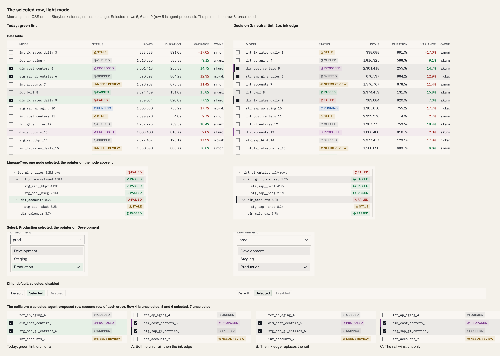
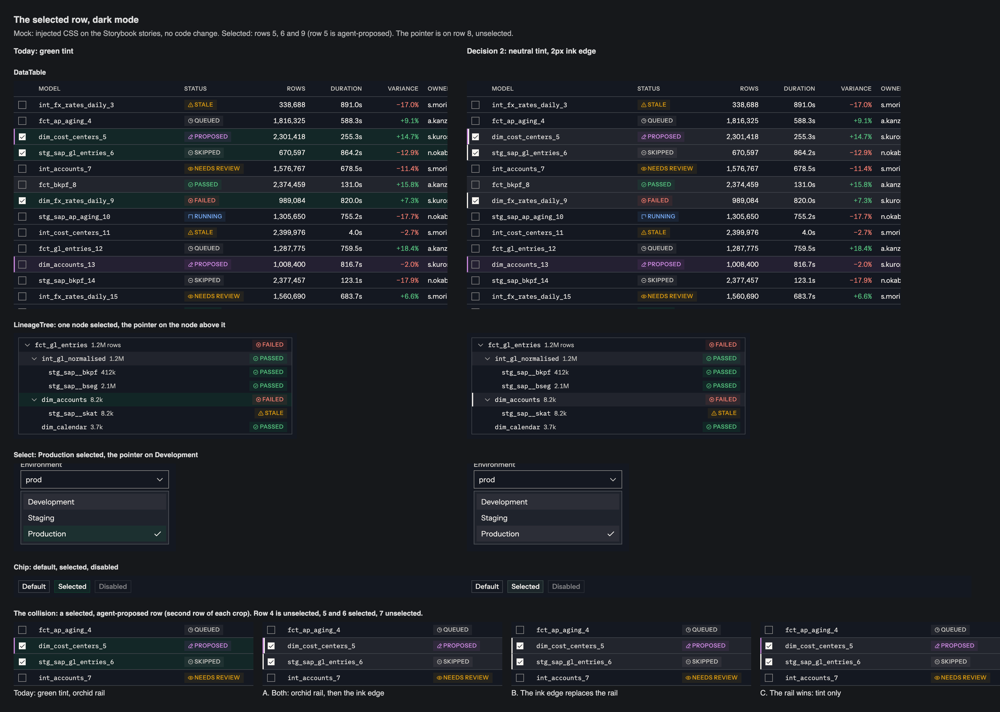

# Links and success share one green: proposal, 2026-11-09

**Status, 2026-11-09:** the owner approved decision 1 the same day, and it is applied: `docs/design-system.md` §1, §2 and §4, the two `--tui-text-interactive` values in `theme.css`, and the link call sites. Decision 2 was declined on 2026-11-10, after the side-by-side it asked for: the selected row keeps its green tint. See "Decision 2, as decided" at the end. The text below is the proposal as written, so "today" in it means before the change.

**Asked of the owner:** two decisions, which can be taken apart.

1. **Links become ink with an underline.** Recommended.
2. **A selected row drops its green tint for a neutral one with an ink edge.** Open: it needs a side-by-side, and it has a collision this file does not solve.

## What this touches

Listed first, as the failure log asks of any token proposal.

| Where | What it says today | Effect |
|---|---|---|
| §1, "Links and selection stay `ivy`, shared with success" (decided 2026-10-16) | Links, selected text and the selection tint are `ivy` | Decision 1 reverses it for links. Decision 2 reverses it for the row tint |
| §1, The Five table | Interactive: `ledger` (fill, ring) · `ivy` (text, tint) | The text half moves to `ledger` |
| §2 and §4, the role tables | `--color-text-interactive` is `ivy-400` dark, `ivy-700` light | Becomes `ledger-50` dark, `ledger-950` light |
| §4, "Three states deliberately have no new token" | A selected row is `--color-bg-interactive` | Decision 2 changes that token's value. No token is added |
| §4, Text selection (decided 2026-11-02, after a side-by-side) | `::selection` is `ivy-500 / 30%` | **Not changed.** See "Left alone" |
| §7.8 | 2px is reserved for the agent rail, the focus ring and the active tab | Decision 2 would add a fourth use |
| §0 rule 4 | Role text is step 400 dark, 700 light | Interactive text would no longer be a hue, so the rule stops applying to it, as it already does for the interactive fill |
| `CLAUDE.md`, design system summary | "Links and selection stay `ivy`" | Needs the same edit |

No token is added, renamed or removed. No sixth hue. `--color-success-*` does not move.

## The problem

§0 rule 1: a hue appears only when something is true about the data, the run, or the user's focus.

A link is none of those. It is an affordance. Today it takes the success hue exactly: in the running demo `--tui-text-interactive` and `--tui-text-success` both compute to `oklch(46.0% 0.115 153.6)` in light mode.

What that does on a real screen, in the Kasane demo, light mode, 1440 × 900:

- **Tasks.** The four titles are open problems: a revenue cut-off error, a duplicate payment, a self-approved entry, a breached credit limit. All four are set in the green that means "passed". The one mark that says "this is yours", the ochre "Needs your answer" badge, is the smallest coloured thing on the screen.
- **Sources.** Nine filenames, all green, and the selected one on a green tint. Nothing on the screen has passed anything.

§1 defends the sharing with "shape carries the difference: a selected row is a full-width tint, a success state is an 18px badge with an icon". That covers the tint. It does not cover link text, which has the same shape as `--color-text-success` text.

A second problem, separate from the hue. In prose a link differs from the text around it by colour alone, and the underline shows only on hover (three `hover:underline` call sites). From §2 and §3's ratios, link against body text is 1.99:1 in light mode (12.44 over 6.24) and 1.91:1 in dark (15.08 over 7.89). WCAG 1.4.1 asks for 3:1 between a link and its surrounding text when colour is the only cue.

## Decision 1: links are ink, underlined

**The change.**

- `--tui-text-interactive` becomes `ledger-950` in light mode and `ledger-50` in dark: the ink of the primary button, 16.49:1 on the canvas in both modes.
- A link is underlined at rest: 1px, offset 2px. The underline is what marks it, since ink beside body text (`ledger-900`, 12.44:1) is not a visible difference.
- **A list where every row is a link drops the underline** and keeps it on hover and focus: `AttachmentRow` in a file list, `Sources`. Nine underlined filenames in a column read as ruled paper, and the list's own shape already says each row opens. A link inside a sentence always keeps it.

**Why the token and not the call sites.** Four places draw a link in the token today: `AttachmentRow`, `InlineCitation`, the demo's `link.ts` and the site's `textLink`. Setting each to `text-text-primary` would leave `--color-text-interactive` meaning "green text" with no link using it. Moving the value keeps one answer to "what colour is a link".

**The site is ahead on one half.** Its `textLink` already underlines at rest. The three in the library and the demo underline on hover only, so they are the ones that change.

**Two site links lose their hover cue.** `standaloneLink` and the component page's neighbour titles are ink at rest and turn green on hover (`hover:text-text-interactive`). With an ink token that hover changes nothing. They would take an underline on hover instead.

**What else reads the token.** Three other uses move with it, and each is better for it or unchanged in meaning:

| Use | Today | After |
|---|---|---|
| `DataTable`'s sort caret, when a column is sorted | Green | Ink. A sorted column is not a success |
| `Chip`, selected | Green text on the green tint | Ink text on the tint, whatever decision 2 makes it |
| `Badge tone="interactive"` | Green text on the green tint | Ink text on the tint |

**Contrast.** Ink on every ground §4 lists is the primary text colour, already gated at 4.5:1 by `check-contrast.mjs`. The role's "worst ground" figure rises from 4.72:1.

**Cost.**

- The interface loses its one warm accent in running text. Light mode, already paper on paper, gets quieter still.
- Underlines add weight to prose with several links in a sentence. Agent replies with many citations use `InlineCitation`'s numbered chip, not a text link, so this is rarer than it sounds.
- A visited state is still not drawn. This proposal does not add one.

## Decision 2: the selected row

Decision 1 can ship alone. After it, green would mean success, plus two things that are the user's focus: a selected row's tint and selected text. Rule 1 allows a hue for focus, so stopping there is defensible.

The case for going further: on Sources and Tasks the selected row would be the only green on the screen, and it would still say nothing has passed.

**The change, if taken.**

- `--tui-bg-interactive` becomes the neutral overlay's value, `ledger-950 / 6%` light and `ledger-50 / 6%` dark.
- The selected row draws a 2px edge in `--color-text-primary` on its leading side.

§1 rejected a neutral tint because it measured 1.04:1 against the hover tint, so a selected row looked hovered. The edge is the answer to that: selection is carried by shape, as the active nav item is carried by weight and a filled icon.

**What is not solved.**

- **It collides with the agent rail.** An agent-proposed row already draws a 2px rail in `--color-text-agent` on the same side (`runStatusRowTreatment`, §5). A selected, agent-proposed row would need both. Putting the selection edge on the trailing side, or letting the rail win and the tint alone mark selection, are both weaker than the plain case.
- **A fourth meaning for 2px.** §7.8 keeps a 2px edge to three uses so that it always means something.
- **`--tui-border-interactive`** has one user, the selected `Chip`. It would need a value too: `--color-border-strong` is the candidate.
- **A hovered, selected row** needs a second step. The active overlay (10%) is the candidate.

I'd take decision 2 only after a side-by-side in Storybook that includes a selected agent-proposed row, in both modes. If that case can't be made to read, keep the green tint.

## Left alone

- **`::selection` stays `ivy-500 / 30%`.** It was decided a week ago after a side-by-side, it is the user's focus in the plainest sense, and the selected text already steps to `--color-text-primary` on it.
- **Every `--color-*-success` token.**
- **The primary button, the focus ring and checked controls.** They are ink already.
- **The active nav item.** It takes no hue already.

## How to see it

The before and after in this review were made by adding this to the running demo, with no code change:

```css
:root,
[data-theme] {
  --tui-text-interactive: var(--tui-text-primary) !important;
  --tui-bg-interactive: var(--tui-bg-hover) !important;
}
.text-text-interactive {
  text-decoration: underline;
  text-decoration-thickness: 1px;
  text-underline-offset: 2px;
}
.bg-bg-interactive {
  box-shadow: inset 2px 0 0 var(--tui-text-primary);
}
```

Drop the second custom property and the last rule to see decision 1 alone. The `box-shadow` is for the mock only: a real edge would be a border, as the agent rail is, with 2px taken off the row's padding.

Checked so far: Tasks and Sources, light mode, one reviewer. **Not checked:** dark mode, the site's prose pages, `InlineCitation`'s popover, grayscale, colour-vision simulation, and any user.

## If approved

In this order, and decision 1 only unless decision 2 is approved as well.

1. Rewrite §1's "Links and selection stay `ivy`" paragraph and the three tables (§1, §2, §4), with the measured ratios.
2. Transcribe the two `--tui-text-interactive` values into `theme.css` and log it in the header.
3. Add the underline at rest to `InlineCitation` and the demo's `link.ts`, the list exception to `AttachmentRow` and `Sources`, and a hover underline to the site's two hover-only links.
4. Update `contrast.spec.ts`'s expected ratios for the interactive role, and `CLAUDE.md`'s summary line.
5. Run §10's checklist. Every story that draws a link, a selected chip or a sorted column changes its screenshot: declare `AttachmentRow`, `Sources`, `InlineCitation`, `Chip`, `Badge` and `DataTable` before the first push.

## Decision 2, as decided

**Declined, 2026-11-10.** A selected row keeps `--color-bg-interactive` at its `ivy` value. Nothing in the spec or `theme.css` changes.

The side-by-side, from the Storybook stories with injected CSS. Left is today, right is the neutral tint with a 2px ink edge. The bottom strip is a selected, agent-proposed row in three treatments.





What it showed:

- **The neutral tint is the hover tint.** A hovered row and a selected row share one ground, so only the 2px edge and the checkbox tell them apart. This is what §1 measured when it rejected a neutral tint.
- **`Select` has no edge to fall back on.** A highlighted option and the selected one differ only by the check mark.
- **The collision with the agent rail has no good answer.** Both marks make a 4px two-colour stripe. If the ink edge replaces the rail, a proposed row loses its rail while selected. If the rail wins, a selected proposed row looks hovered.
- **Today's green has none of these.** Selected, hovered and proposed rows are three distinct grounds. Since decision 1, green on a row means selection or a success badge, and the badge has its own shape.

**Not shown:** a hovered selected row, and the demo's Tasks and Sources screens.
