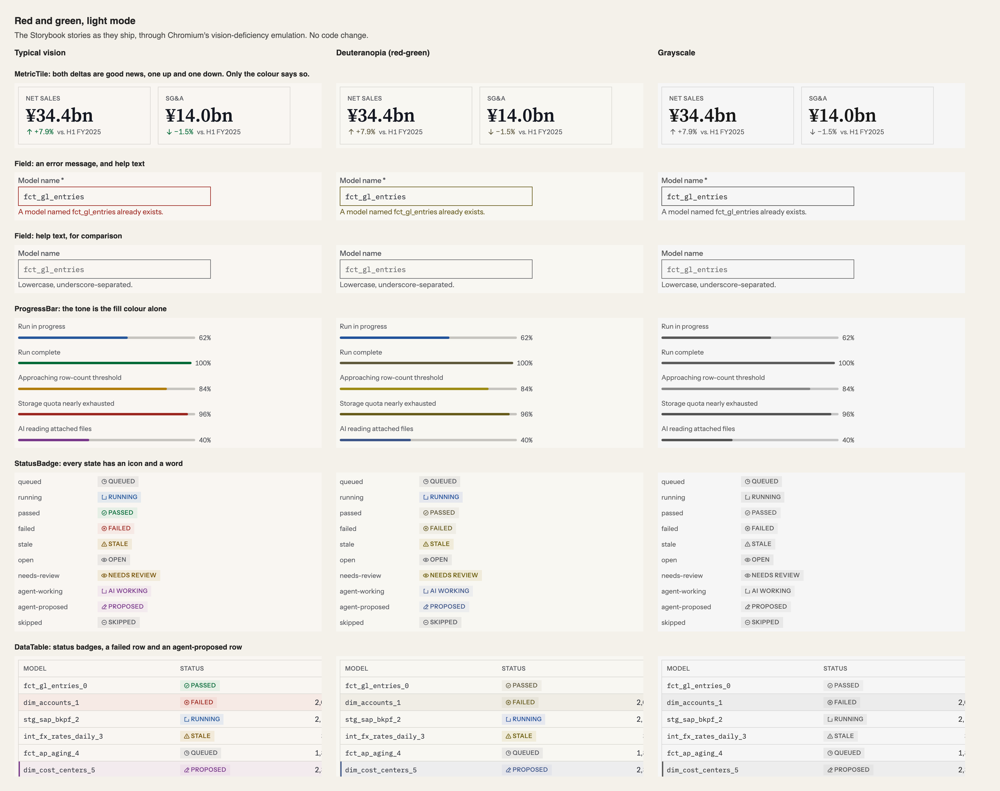
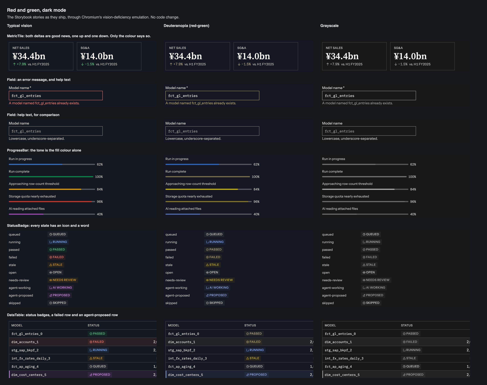
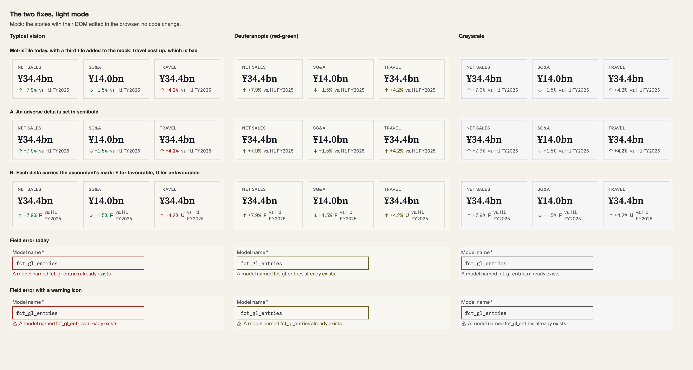
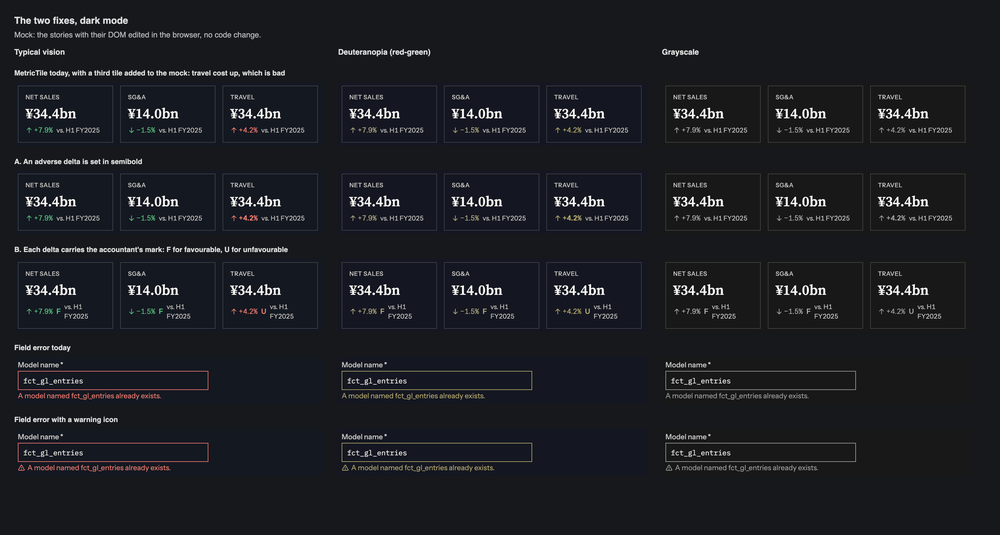

# Red and green for colour-blind users: proposal, 2026-11-11

**Status, 2026-11-11:** the owner set decision 2, `MetricTile`'s mark, aside for now: this is a personal project, not a commercial product. Decisions 1 and 3 were taken the same day and are applied: `Field`'s error icon, §11.2, and `ProgressBar`'s README. The text below is the proposal as written.

**The palette's cost is already known and accepted. This proposal does not reopen it.** §1 records that, for deuteranopes, danger and success become nearly the same colour, and answers it with a rule: "every hue-coded state carries an icon or label as well". What this proposal finds is three places where that rule is not kept, so colour is the only thing that says good or bad.

**Asked of the owner:** two decisions and one note.

1. **`Field`'s error message gets a warning icon.** Recommended.
2. **`MetricTile`'s delta says whether it is good news without colour.** Recommended, and the form is your call: option A or B below.
3. **`ProgressBar`'s tone: a sentence in its README, no code.** Recommended.

## What this touches

| Where | What it says today | Effect |
|---|---|---|
| §1, "This is the palette's main cost" (measured 2026-10-16) | Danger and success converge for deuteranopes. Separating them "means changing the generator, not a token" | **Not changed.** No colour moves |
| §1 and §11.1 | Every hue-coded state carries an icon or label. Colour is never used alone | Decisions 1 and 2 apply it where it is missing |
| §11.2 | Error and alert icons draw `bold`, "a redundant non-colour channel so the state survives grayscale" | Decision 1 adds the icon that row describes |
| §5, "Financial polarity" | Positive variance is success, negative is danger | Decision 2 adds a non-colour mark. The colours stay |
| `MetricTile`, `higherIsBetter` | The prop that "keeps a rising cost from rendering green" | It already knows good from bad. Decision 2 shows it without colour |
| `Field`, "error replaces help" | One message under the control, in `--color-text-danger` when it is an error | Decision 1 adds an icon to the error form |

No token is added or changed. `Field`, `MetricTile` and `ProgressBar` are product components, so none of this is a foundational edit.

## Measured

Distance between the role colours as text, in OKLab × 100, for typical vision and under simulated deuteranopia and protanopia (Machado 2009, full severity, on the hex values in `docs/palette.json`).

| Pair | Mode | Typical | Deuteranopia | Protanopia |
|---|---|---|---|---|
| Success, danger | Light | 24.0 | **4.2** | 10.8 |
| Success, danger | Dark | 25.8 | **3.1** | 10.7 |
| Danger, warning | Light | 11.8 | **1.1** | 6.5 |
| Danger, secondary text | Light | 16.0 | 9.6 | 10.4 |
| Danger, agent | Light | 17.0 | 17.3 | 17.3 |

§1's own figure for success against danger is 2.4–3.7, by a different method, so the two agree. Every ramp shares one lightness curve (rule 4), so once the hue is lost nothing else separates the three: success, danger and warning are one olive to a deuteranope, and one grey in grayscale.

## Where the rule holds

`StatusBadge` and every row that uses one: each state has its own icon and its own word. The sheet shows all ten staying apart under deuteranopia and in grayscale. The failed and agent-proposed rows in `DataTable` carry a badge as well as a tint. `AgentBlock` has its rail and its label. Links are ink and underlined.

## Where it does not

**1. `Field`'s error.** An invalid field differs from a valid one with help text in two ways, both colour: the border and the message turn `--color-text-danger`. That step has the same lightness as the neutral text and edge it replaces. In grayscale the two fields are identical. Under deuteranopia the error is a brownish olive against grey, which is weak. The wording of the message is the only other cue, and help text can read like an instruction too.

**2. `MetricTile`'s delta.** The arrow shows direction and the colour shows whether that direction is good. Net sales up 7.9% and SG&A down 1.5% are both good news, and both are green. A cost that rose would show the same up arrow as sales, in red. Without colour, a reader sees an arrow and a figure and has to know the metric to judge it, which is the judgement the tile exists to make for them. A screen reader gets the same: the delta's text and nothing about polarity.

**3. `ProgressBar`'s tone.** The fill colour is the only expression of `tone`. In its own story the labels happen to say what the colour means ("Storage quota nearly exhausted"). Nothing requires that.

## Decision 1: an icon on the error message

`Field` draws Phosphor's `Warning` at `bold` before an error message, in the message's colour, `aria-hidden`. Help text gets no icon. An invalid field is then marked by shape in grayscale and under any colour vision.

It costs 16px of the message's line, and nothing in height.

## Decision 2: a delta that says good or bad

The fixes sheet shows both, under all three kinds of vision. The third tile, "Travel", is added to the mock as an adverse case: a cost that went up. Its headline figure is a copy of the first tile's and means nothing.

**A. An adverse delta is semibold.** Quiet, and no new mark. It only reads by comparison: one tile alone gives the reader nothing to compare its weight with.

**B. Each delta carries a letter: F for favourable, U for unfavourable.** This is the mark variance reports already use, so the product's users know it, and it reads on a single tile. It adds a character to every delta, good ones included.

**I recommend B**, with one condition: you know your users' vocabulary and I don't. If "F" and "U" are not what they write, the same slot can hold the words they do use. Either way the tile should also give assistive technology the word ("favourable", "unfavourable"), which it lacks today under both options.

Zero stays neutral and takes no mark.

## Decision 3: a sentence for `ProgressBar`

Its README says: a tone is never the only statement. The label, or a `StatusBadge` beside the bar, says what the colour means. No code changes: a bar is 2px or 4px tall and has no room for a mark of its own.

## How to see it

The first pair is the stories as they ship, through Chromium's vision-deficiency emulation. The second pair is the two fixes, mocked by editing the stories' DOM in the browser.

**Not checked:** protanopia and tritanopia on screen (protanopia is in the table only), a variance column in an app's own table where good is not the same as positive, charts, the demo and the site, and any colour-blind user. The simulation is a model of colour blindness, not a person's report of it.

## If approved

1. §5: a short paragraph under "Financial polarity" for the mark, and §11.2's error row names `Field`.
2. `Field`: the icon, with a test that an error message holds one and help text does not, and a grayscale check that the two differ.
3. `MetricTile`: the mark and the accessible word, with tests for good, adverse and flat.
4. `ProgressBar`'s README.
5. Screenshots change for `Field`, `MetricTile` and every story with a field error. Declare them from a sweep of all stories before the first push.
