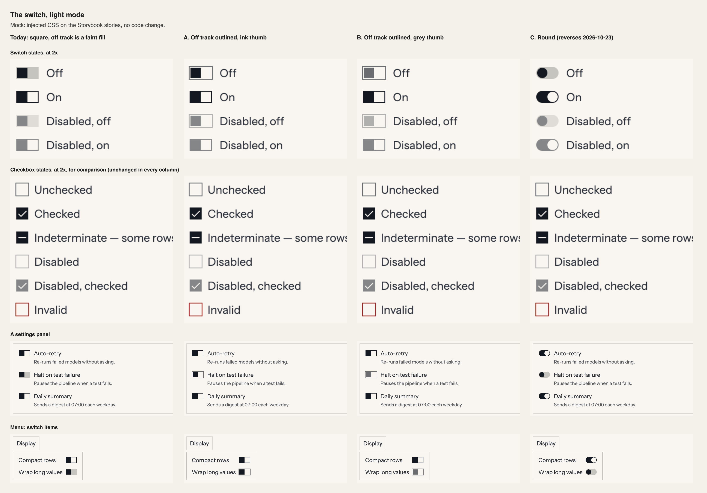
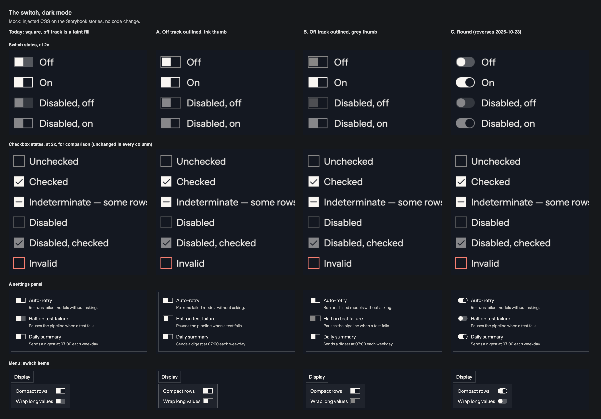

# The square switch: proposal, 2026-11-10

**Status, 2026-11-10:** the owner chose option C the same day, reversing the 2026-10-23 decision. It is applied: `docs/design-system.md` §7.7, `Switch/variants.ts`, and `switch.spec.ts`. Colours and geometry are unchanged. The text below is the proposal as written.

**A correction first.** My critique on 2026-11-09 said a square switch can be mistaken for a checkbox. The side-by-side does not bear that out: next to a checkbox, the switch's 28 × 16 track reads as a different object. What the sheets show is a different problem. **On and off look alike**, because both put the heavy mark on the left.

**This reopens a locked decision in part.** §7.7 records the switch as square since 2026-10-23, the owner's decision after a side-by-side, with the checkbox risk "in view". Option B below keeps that decision and changes only the off state's colours. Option C reverses it. Nothing here should be taken without the owner looking at the sheets.

**Asked of the owner:** one choice.

- **Keep today's switch.**
- **B. The off state is outlined, with a grey thumb.** Recommended.
- **C. Round again.** Clearest, and it reverses 2026-10-23.

Option A is in the sheets because it was my first idea, and it fails. It is not offered.

## What this touches

| Where | What it says today | Effect |
|---|---|---|
| §7.7, "The switch is square since 2026-10-23" | Track `--radius-md`, thumb `--radius-sm`. "A switch reads by its track, wider than it is tall, with the thumb parked at one end" | B keeps it. C reverses it |
| §4 "Control edge", and `docs/reviews/control-borders-2026-11-10.md` | `Switch` was left out of `--color-border-control` on purpose: "its off state reads by its thumb" | B brings it in: the off track takes the control edge |
| `Switch/variants.ts` | Off track is `--color-border-strong` as a fill, off thumb is `--color-text-primary` | B: off track is transparent with a `--color-border-control` edge, off thumb is `--color-border-control` as a fill |
| `Menu`'s switch indicator | Shares `switchVariants` | Changes with it |
| `switch.spec.ts` | The thumb sits exactly 2px inside the track | Unchanged. The 1px border is already in the box; B gives it a colour |
| `aria-invalid` on `Switch` (2026-11-10) | The border turns `--color-text-danger` | Unchanged, and must still win over the new edge |
| `Switch` is foundational | | This is the ask for that edit |

No token is added. No geometry changes under B.

## The problem

The thumb is 12px in a 28px track with a 2px inset, so the thumb and its inset are exactly half the track. The thumb also flips colour with the state, ink when off and paper when on, so that it clears its ground in both.

Put together:

- **Off:** an ink square on the left, a faint fill on the right.
- **On:** an ink track showing on the left, a paper thumb on the right.

Both states are "dark on the left, light on the right". They differ only in the right half: a faint grey fill when off, paper inside a 2px ink ring when on. In the settings panel at normal size, the one off switch among three is hard to pick out. Dark mode is the same with the colours swapped.

A round thumb does not have this problem with the same colours, because a circle inside a pill is seen as an object. A square that fills half a rectangle is seen as half the rectangle.

The off track adds to it. It is `--color-border-strong` as a fill: 1.62:1 on paper and 2.49:1 on the dark canvas (§3). The shape §7.7 says a switch "reads by" is under 3:1 in both modes, so in the off state the thumb is most of what can be seen.

## The options

**A. Outline the off track, keep the ink thumb. Not offered.** This was the obvious fix for the faint track: give it the control edge. It makes the real problem worse. Off becomes an outlined box with an ink square on the left, and on is an ink box with a paper square on the right, which also reads as an outlined box, dark on the left. In the settings panel the two are nearly identical.

**B. Outline the off track, and make the off thumb grey. Recommended.** The off track is transparent with a `--color-border-control` edge, and the off thumb is the same colour as a fill: `ledger-600` on paper and `ledger-500` on the dark canvas, 4.89:1 and 4.95:1, and 3.70:1 on the worst ground measured for that token. On is unchanged.

- State is then carried by weight as well as position: off is light and grey, on is solid ink. That is the checkbox's own grammar, outlined when off and filled when on.
- The track's shape clears 3:1 in both states.
- The cost: the on state still has its dark half on the left. B separates the two states; it does not make the on thumb read as a thumb.
- A disabled off switch gets fainter, a grey thumb at 50%. It is disabled, so that is within §3's rule, but look at it in the sheet.

**C. Round again.** The pill and circle read as a switch at any size and in either state, with today's colours. It reverses the 2026-10-23 decision and makes the switch the one control that is not square. I'd take it only if B does not read well to you.

## How to see it

Both sheets were made from the Storybook stories with injected CSS, no code change. Columns are today, A, B and C. The first two rows are at 2x.

**Not checked:** a focused, hovered or invalid switch, forced colours, grayscale, a switch on a hovered row, the `sm` size, and any user. The contrast figures are §3's and the control-edge proposal's, not read from these mocks. "Hard to pick out" is my reading of the sheet, not a measurement.

## If approved (B)

1. §7.7: add the off state's treatment to the switch paragraph. §4 "Control edge": move `Switch` from the controls left out to the ones that use the token.
2. `Switch/variants.ts`: the off track and off thumb classes, with `aria-invalid` still winning the border.
3. Tests: `switch.spec.ts` keeps its 2px insets and gains the off track's edge colour and the thumb's fill, in both modes. Add the off switch's edge to `check-contrast.mjs`'s 3:1 gate if the token's existing gate does not already cover it.
4. Screenshots change for every story with an off switch: declare `Switch` and `Menu`, and whatever a sweep of all stories finds, before the first push.
