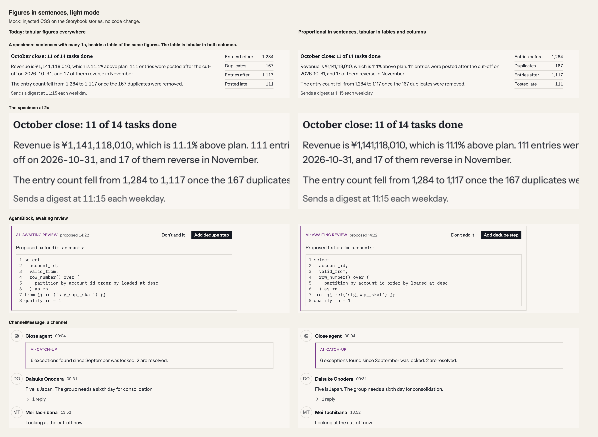
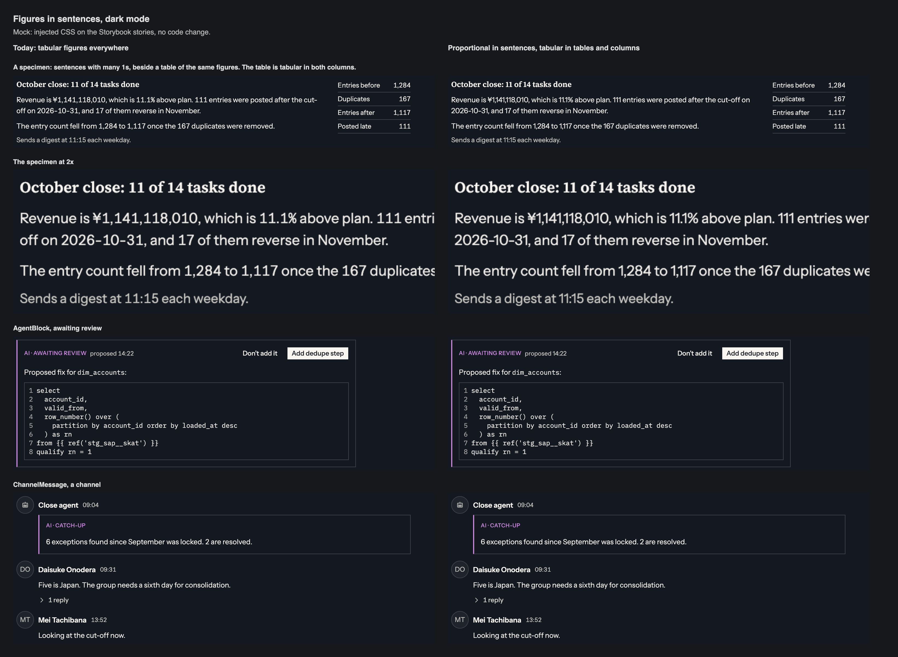

# Tabular figures in sentences: proposal, 2026-11-11

**Status, 2026-11-11:** the owner kept tabular figures everywhere the same day. §8.6 records the re-check and the separator finding. Nothing else changed. The text below is the proposal as written.

**The recommendation is to change nothing.** My critique on 2026-11-09 said tabular figures make sentences look loose and that prose should take proportional ones. The side-by-side shows the opposite risk is worse: with proportional figures, the separators between 1s nearly disappear, and `11.1%` can be read as `111%`. The rule should stand, with one sentence added to the spec saying why.

**This would reopen a non-negotiable.** `CLAUDE.md` rule 7 is "all numbers carry `tabular-nums`", and §8.6 extended it to prose on 2026-10-07. The owner re-affirmed it on 2026-10-16 and 2026-11-07, the second time knowing the gap was at its widest. Nothing here should change without the owner looking at the sheets.

**Asked of the owner:** one choice.

- **Keep tabular figures everywhere.** Recommended.
- **Proportional figures in sentences, tabular in tables and columns.** Not recommended.

## What this touches

| Where | What it says today | Effect of the alternative |
|---|---|---|
| `CLAUDE.md` rule 7 | All numbers carry `tabular-nums` | Would become "all numbers in a column or a figure that changes in place" |
| §8.6 | Set once on `html`, inherited everywhere, prose included (2026-10-07) | Sentences would opt out |
| §8.6's reason | A reply's `1,284` sits at the same width as the table's `1,284` | Given up |
| 49 `tabular-nums` declarations | Redundant under inheritance, kept to document intent | Would become load-bearing. Any figure that aligns or ticks and relies on inheritance today would have to gain one |

Under the recommendation, nothing changes but one added sentence in §8.6.

## Measured

Each digit's advance in em, from the loaded fonts in Chromium, proportional then tabular.

| Digit | Instrument Sans, 400 | Source Serif 4, 600 |
|---|---|---|
| 0 | 0.679 → 0.600 | 0.499 → 0.488 |
| **1** | **0.380 → 0.600** | **0.372 → 0.488** |
| 2 | 0.556 → 0.600 | 0.475 → 0.488 |
| 3 | 0.574 → 0.600 | 0.470 → 0.488 |
| 4 | 0.600 → 0.600 | 0.494 → 0.488 |
| 5 | 0.572 → 0.600 | 0.474 → 0.488 |
| 6 | 0.617 → 0.600 | 0.495 → 0.488 |
| 7 | 0.544 → 0.600 | 0.461 → 0.488 |
| 8 | 0.604 → 0.600 | 0.480 → 0.488 |
| 9 | 0.620 → 0.600 | 0.495 → 0.488 |

**The whole cost is the digit 1.** In the sans a tabular `1` is 58% wider than a proportional one: 2.9px more at 13px, about 1.4px on each side. Every other digit moves by 0.08em or less, and the zero gets narrower.

So a sentence with no 1 in it is unchanged: "Sends a digest at 07:00 each weekday." measures 226.8px proportional and 226.5px tabular at 13px. A sentence full of them is 14% wider: "In 2011, 11 of 111 accounts" goes from 144.3px to 164.4px.

## What the side-by-side shows

**Tabular, today.** Runs of 1s look loose: "11 of 14", "111 entries", "11:15". That is the cost §8.6 already names.

**Proportional.** The same runs tighten, and so does the space around a comma or a decimal point that sits between two 1s, because the narrow `1` brings its neighbours in with it:

- `11.1%` closes up until the point is hard to see. It can be read as `111%`.
- `¥1,141,118,010` and `1,117` lose their grouping at reading size. The commas are there, but the eye does not get the groups of three.

In a product whose agent states figures a user then checks against a table, a decimal point that goes missing is the worse failure. Loose 1s are an appearance cost; a misread `11.1%` is a correctness one, which is the standard rule 7 sets for itself.

**The alternative is also fragile to build.** The mock had to mark what stays tabular, and it missed things straight away: the timestamps in `ChannelMessage` and the "proposed 14:22" in `AgentBlock` went proportional, because they rely on inheritance today. Timestamps down a message list are a column. Any elapsed counter that relies on inheritance would start to jitter as it ticks.

## Recommendation

Keep the rule. Add one sentence to §8.6: tabular figures in a sentence also keep a decimal point or a comma between two 1s readable, measured 2026-11-11. That gives the rule a second reason that does not depend on the first, which was about matching a table's width and is the weaker of the two.

## How to see it

Both sheets were made from the Storybook stories with injected CSS, no code change. The first two rows are a specimen I wrote, with many 1s on purpose, beside a table of the same figures. The last two are stories as they ship.

**Not checked:** the site's long-form pages, headings at display sizes, a low-density display (the sheets are 2x), other locales' separators (a thin space, or a point for grouping), and any user. "Can be read as `111%`" is my reading of the sheet, not a measurement. The specimen is a worst case: most product sentences have fewer 1s.

## If the recommendation is taken

1. §8.6: the one sentence, with the per-digit table's headline figure.
2. Nothing else. No token, component or screenshot changes.
