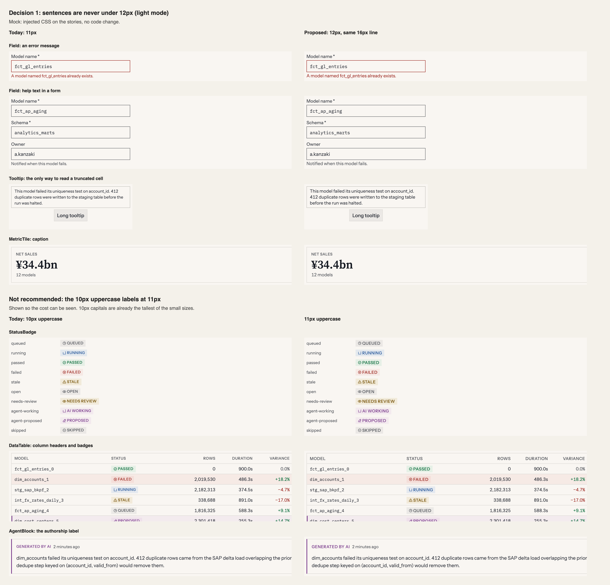
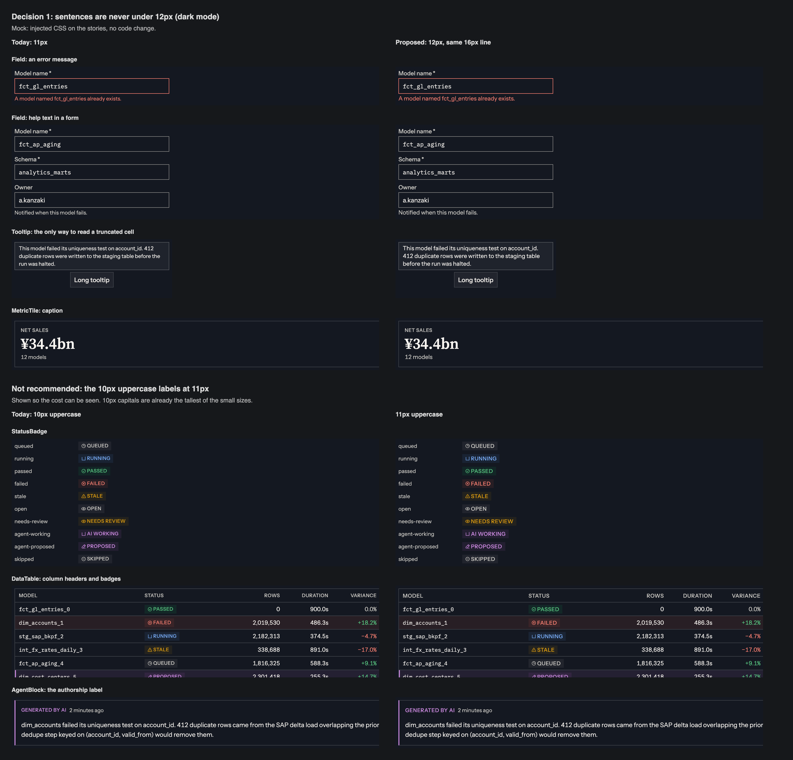

# The type floor: proposal, 2026-11-10

**Status, 2026-11-10:** the owner took both decisions the same day, and they are applied: `docs/design-system.md` §8.1 "The floor" and §8.8, `Field`'s message and `Tooltip` at `--text-sm`, and the lint rule in `eslint.config.js`. `MetricTile`'s caption stays 11px. The lint rule accepts `tabular-nums` as the mark of a figure, where this proposal suggested an allow-list. The text below is the proposal as written.

**A correction first.** My critique on 2026-11-09 named the 10px labels as the problem. Measured, they are not the smallest text in the product. The smallest is 11px lowercase, and it carries sentences: error messages, help text and tooltips. The proposal follows the measurement, not the critique.

**Asked of the owner:** two decisions, each separable.

1. **A sentence is never set under 12px.** `Field`'s message and `Tooltip` move from `--text-xs` to `--text-sm`. Recommended.
2. **`--text-2xs` stays 10px, and "uppercase only" becomes a lint rule.** Recommended. The alternative, raising it to 11px, is shown below and not recommended.

## What this touches

| Where | What it says today | Effect |
|---|---|---|
| §8.1, the scale | `--text-xs`: "timestamps, secondary metadata, help text" | Decision 1 takes "help text" out of that line and adds it to `--text-sm`'s |
| `Tooltip`, foundational | `text-xs`, under the comment "§8.1 `--text-xs` is help text" | Decision 1 edits a foundational component. This is the ask |
| `Tooltip` README | "11px/16px text at 4px plus the 1px border renders 26px tall" | Still 26px: `--text-sm` has the same 16px line |
| §3, tertiary (decided 2026-10-08) | Help text is read, so it is `--color-text-secondary` | Same reasoning, applied to size. No colour changes |
| §8.8 | `--tracking-wide`: "`--text-2xs`, uppercase only" | Decision 2 enforces it. The value does not change |
| §8.3, mono one step down (owner, 2026-11-07, after a side-by-side) | An identifier in a 12px row is 11px mono | **Not changed.** See "Left alone" |
| `lint/` | No rule on `text-2xs` | Decision 2 adds one |

No token is added, renamed or changed in value. No colour, spacing or height changes.

## Measured

Glyph heights, from the loaded fonts in Chromium (`measureText` on `H` and `x` at 1000px, both weights the same). Instrument Sans has a cap height of 0.720em and an x-height of 0.510em. IBM Plex Mono's x-height is 0.516em.

| Setting | Where | Height of the letters |
|---|---|---|
| 10px uppercase sans | Badges, column headers, section labels | **7.2px** |
| 13px lowercase sans | Body | 6.6px |
| 12px lowercase sans | Table cells, form labels | 6.1px |
| 11px lowercase mono | Identifiers in a 12px row | 5.7px |
| 11px lowercase sans | Help text, error messages, tooltips, metadata | **5.6px** |

So a 10px `NEEDS REVIEW` is drawn taller than body text, and the smallest letters on any screen are 11px lowercase.

`text-xs` appears 57 times outside stories and `text-2xs` 15 times. Of the 11px uses, most are metadata that is a figure or a word or two: timestamps, file sizes, durations, counts. Three carry sentences:

- **`Field`'s message.** It is the help text under a control and, when the control is invalid, the error. The error is the only explanation of what went wrong, and it is the smallest text in the form: smaller than the label above the control and the value inside it.
- **`Tooltip`.** `CLAUDE.md` calls it "not optional; truncated table cells are unreadable without it". The text it reveals is set smaller than the cell it came from.
- **`MetricTile`'s caption**, when it is a phrase.

## Decision 1: a sentence is never under 12px

`Field`'s message and `Tooltip`'s popup take `text-sm`. §8.1's descriptions change to match: `--text-xs` is "timestamps, secondary metadata", and `--text-sm` adds "help text, error messages".

**Why these and not all 57.** The rest is metadata set beside larger text that carries the meaning. A timestamp beside a message, or a file size beside a filename, is read after the thing it describes, and the step down is what says so. An error message has nothing larger beside it that says the same thing.

**What it costs.**

- Nothing in height. `--text-xs` and `--text-sm` share a 16px line, so no field, form or tooltip gets taller.
- About 9% in width. A long tooltip wraps a few words earlier, as the sheet shows.
- A field's message is then the same size as its label. Both are `--color-text-secondary`, so help text then differs from its label by weight alone (the label is `font-medium`) and by sitting under the control. An error is `--color-text-danger`. This is the part to look at in the sheet.

**`MetricTile`'s caption** is in the mock at 12px. I'd leave it at 11px: it sits under a 32px figure, it is usually two words, and the step down is doing its job there. Say if you want it included.

## Decision 2: 10px stays, and stays uppercase

The 10px size is safe only because it is set in capitals. Lowercase at 10px would be 5.1px tall, under everything in the table above. §8.8 already says "uppercase only". Nothing checks it.

One place breaks it today: the site's colour page sets ramp step numbers as `<code className="text-2xs">`, mono at 10px, not uppercase. They are digits, and lining figures usually stand near cap height, though I did not measure these. That is the exception a rule would need: `CountBadge` is digits at this size too.

**The change.** A lint rule: a class string with `text-2xs` must also carry `uppercase`, or the element is on a short allow-list for figures (`CountBadge`, the site's step labels). No visual change.

**The alternative, not recommended: 10px becomes 11px.** The sheet shows it. Every badge and header gets about 10% wider: `NEEDS REVIEW` goes from 80px to 88px of text, `AGENT PROPOSED` from 98px to 108px. An 18px badge then holds a 16px line with 1px to spare, where it holds a 14px line with 2px today. The capitals go from 7.2px to 7.9px, larger than anything short of a heading. It buys height the labels don't need and spends width a dense table does.

## Left alone

- **Mono identifiers at 11px in 12px rows.** At 5.7px they are close to the floor, and they are the most-read text in the product. The owner compared 1em, 0.92em and 0.9em on 2026-11-07, in both modes, and kept the step down. I'd reopen it only with that side-by-side in hand, not as part of this.
- **Timestamps, sizes, durations and counts at 11px.**
- **Every value on the scale.**

## How to see it

Both sheets were made from the Storybook stories with injected CSS, no code change. The top half is decision 1. The bottom half is the alternative to decision 2.

**Not checked:** a tooltip over a real truncated cell, the demo and the site, a low-density display (the sheets are rendered at 2x), text at 150%, and any user. The letter heights are font metrics, not a legibility test.

## If approved

1. §8.1: move "help text" from `--text-xs`'s line to `--text-sm`'s, with the table of letter heights and the rule "a sentence is never under 12px".
2. `Field`'s message and `Tooltip` take `text-sm`. Update `Tooltip`'s comment and README.
3. Decision 2: the lint rule, with a probe file through `eslint --stdin` to show it fails closed, and the two figure exceptions.
4. Screenshots change for every story with a field message or an open tooltip. Declare `Field`, `Tooltip`, `Dialog` and whatever a local sweep of all stories finds, before the first push.
