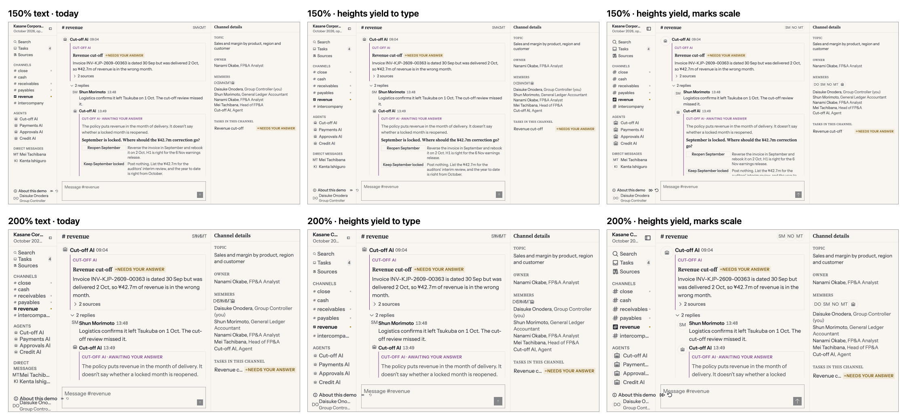

# What happens when a user enlarges their text: proposal, 2026-11-10

**Status, 2026-11-10:** the owner took decisions 1 and 2 the same day, and they are applied: `docs/design-system.md` §7.5 and §7.6, the five `--h-*` values in `theme.css`, `DataTable`'s virtualizer, `Avatar` and `ChannelMessage`, and `apps/storybook/tests/type-scaling.spec.ts`. Decision 3, standalone icons, was not taken. The text below is the proposal as written.

**A correction first.** My critique on 2026-11-09 said the px grid "holds only to about 125%" and that a badge overflows at 128%. Both were wrong. Measured here, nothing is clipped until 150%, and controls and rows hold until past 175%. The problem is real but smaller and later than I said, and its first symptom is not the one I named.

**Asked of the owner:** three decisions, each separable.

1. **Control and row heights yield to their text** once the text would no longer fit. Recommended.
2. **Avatars scale with type.** Recommended: this is the first thing that breaks.
3. **Standalone icons scale with type.** Open. It reverses a rule §11.3 took on purpose.

## What this touches

| Where | What it says today | Effect |
|---|---|---|
| §0 rule 10 and §7.5 | Type in rem; spacing, control heights and radius in px. "The grid should hold its geometry while the type scales within it" | Decision 1 keeps this up to the point where the type no longer fits within it, then lets a height grow. Spacing and radius stay px |
| §0 rule 5 and §7.6 | No control above 36px, no default row above 28px | True at the default text size. Above about 125% a height can exceed it, by the user's own setting |
| §7.6, the five `--h-*` values | Plain px | Each becomes `max(<today's px>, <its line-height in rem> + 4px)`. No value changes at 100% |
| `lint/stylelint-tui.mjs`, `tui/dimension-caps` | Reads the px lengths in a `--h-*` declaration and caps them at 36 | Still passes: the px in each `max()` are today's value and 4. It no longer sees the whole value, which should be said in the rule |
| `DataTable`, `ROW_HEIGHT = 28` | "Virtualization needs a number, not a var" | Must read the token at runtime. This is the failure-log entry on a px literal restating a token |
| Failure log, row height on the cell | A row is `--h-row-sm` on the `<td>`, and the virtualizer estimates 28 | Unchanged at 100%. With decision 1 the estimate has to follow the token |
| §11.3 | A standalone icon is sized by the grid, in px, on purpose | Decision 3 reverses it |
| `Avatar` README | `size-6` and `size-8`, "there are no avatar size tokens" | Decision 2 writes the two sizes in rem, as literals. `Avatar` is foundational, so this is the ask for that edit |

No colour, hue or radius changes. Nothing changes at the default text size under any of the three.

## Is this an accessibility failure?

Not against the standard `PRODUCT.md` names. WCAG 1.4.4 asks that text can be resized to 200% without loss, and browser zoom satisfies it: zoom scales px and rem together, and this layout reflows. I also ran WCAG 1.4.12's text-spacing overrides (line height 1.5, letter spacing 0.12em, word spacing 0.16em) on the demo at 100% and nothing was clipped.

What fails is the system's own claim. §7.5 chooses px geometry so that a user who raises their **browser's font size** gets larger text in the same grid. That holds for a while and then stops, and the spec does not say where.

## Measured

The Kasane demo, 1440 × 900, light mode, channel, Tasks and Sources screens together, with the root font size set to each value. "Text taller than its box" counts text whose rendered height exceeds the control, row or badge that holds it. The count of 1 at 100% is a false positive of the method and is the baseline.

| Text size | Text taller than its box | Initials wider than their avatar |
|---|---|---|
| 100% | 1 | 0 |
| 125% | 1 | 0 |
| 140% | 1 | 0 |
| 150% | 1 | **11** |
| 175% | 1 | 14 |
| 200% | **40** | 14 |

So the order is:

1. **From 150%, avatar initials spill.** A 24px avatar holds 11px initials. At 150% they are wider than the circle, and in `PresenceStack` they run together: "SM NO MT" reads as "SMNOMT".
2. **Standalone icons shrink against their labels, from the first step.** They never clip, so no count shows it. At 200% a 16px nav icon sits beside a 26px label. §11.3 sizes that icon at about 1.3 times the label's cap height so the column can be scanned icon-first; at 200% it is about 0.85.
3. **Near 200%, controls and rows give out.** A 32px control holds a 20px line at 100% and a 40px line at 200%. Nav rows collide, and button and row text is taller than its box in 40 places.

## Decision 1: heights yield to their text

Each height token keeps today's value until its own line of text, plus 4px, is taller.

```css
--h-row-xs:     max(24px, 1rem + 4px);    /* --text-sm's 16px line */
--h-row-sm:     max(28px, 1rem + 4px);
--h-control-sm: max(24px, 1rem + 4px);
--h-control:    max(32px, 1.25rem + 4px); /* --text-base's 20px line */
--h-control-lg: max(36px, 1.25rem + 4px);
```

| Text size | `--h-control-sm`, `--h-row-xs` | `--h-row-sm` | `--h-control` | `--h-control-lg` |
|---|---|---|---|---|
| 100% | 24 | 28 | 32 | 36 |
| 125% | 24 | 28 | 32 | 36 |
| 150% | 28 | 28 | 34 | 36 |
| 200% | 36 | 36 | 44 | 44 |

**Why at the token.** About thirty class strings across fifteen components read these five tokens, and `IconButton` squares itself on the same ones. One change in `theme.css` reaches all of them, and no component can forget it.

**Why 4px and not the padding a control has today.** A 32px control gives its 20px line 6px above and below. Keeping that (`1.25rem + 12px`) is the first formula I mocked, and it made every nav row taller at 150%, where nothing was clipped. That gives up rows the user had not lost, which is the cost §7.5 exists to avoid. 4px is this system's floor between two distinct objects (§7.3), here a line of text and its control's edge.

**The cost.** Above about 125% the grid is no longer fixed: a user at 150% sees 28px dense rows where there were 24, and at 200% a fifth to a third fewer rows than today (28px rows become 36, and 24px rows become 36). Today they would see the same number of rows with the text spilling out of them.

**What must change with it.** `DataTable`'s virtualizer estimates rows at a literal 28. It would have to read `--h-row-sm` from the page, as `popupRowInset()` reads its tokens, or scroll position drifts at large text sizes. That is the one code change this decision needs.

## Decision 2: avatars scale with type

`Avatar`'s two sizes become 1.5rem and 2rem: 24px and 32px at the default, as now.

An avatar is a mark with text inside it. Holding the circle at 24px while its initials grow is the one place where the geometry-holds rule produces a broken object and not just a tight one. The alternative, holding the initials in px so they never grow, makes them the only text in the product that ignores the user's setting.

The README says to ask for a token when a third size or component needs one. This is not that: it is the same two sizes in a different unit, so two literals in `Avatar` (`size-[1.5rem]`, `size-[2rem]`) are enough, and both are under the lint gate's caps. No token is asked for.

## Decision 3: standalone icons scale with type

`--size-icon-xs` through `--size-icon-lg` become 0.75rem, 0.875rem, 1rem and 1.25rem: the same px at the default.

§11.3 decided against this: a standalone icon is "sized by the grid rather than by adjacent text". That reasoning holds for an icon alone in a toolbar. It is weaker for a nav row, where the same section sets the icon in proportion to its label, and the proportion is what large text breaks.

I lean yes, weakly. With decision 1 the grid itself grows at large sizes, so an icon sized by the grid would grow too, and rem is the simplest way to say so. The case against: fractional icon sizes (17.6px at 110%) can soften a 1px stroke on a 1x display, and this was not looked at.

If this is declined, decisions 1 and 2 still stand, and icon-only controls keep a 16px glyph in a control that grows around it.

## How to see it

Rows are 150% and 200% text. Columns are today, decision 1 alone, and all three decisions.



With all three, both counts in the table above return to the baseline at every size.

Still visibly wrong at 200% in the right-hand column, and not part of this proposal:

- **The demo's sidebar footer** ("About this demo" and its two buttons) is wider than the 240px sidebar and runs into the composer. That is the demo's own layout in `App.tsx`.
- **The sidebar and panel are fixed at 240px and 440px**, so labels truncate early and main gets narrow. §7.9 gives widths no cap and no scaling. A user at 200% would be better served by the collapsed sidebar, which exists.

**Not checked:** dark mode, Storybook stories (a `DataTable`, an open menu, a dialog), the site, real browser font-size settings as opposed to a root override, Safari and Firefox, and any user. The mock is injected CSS, so `DataTable`'s virtualizer was not exercised.

## If approved

1. Rewrite §7.5 to say where the geometry holds and where it yields, and give §7.6's five tokens their formulas and the table above. Note the cap in §0 rule 5 as "at the default text size".
2. Transcribe the five values into `theme.css` and log it in the header.
3. `DataTable` reads `--h-row-sm` at runtime. A test sets the root font size and asserts the virtualizer's row height follows.
4. Decision 2: the avatar sizes, in the spec first.
5. Decision 3, if taken: the four icon tokens, and §11.3's "Standalone" paragraph.
6. A spec that loads a few stories at 150% and 200% and asserts no text is taller than its box, so this cannot regress unnoticed.
7. No screenshot should change: every value is identical at 100%. A change in any baseline would be a bug in the formulas.
