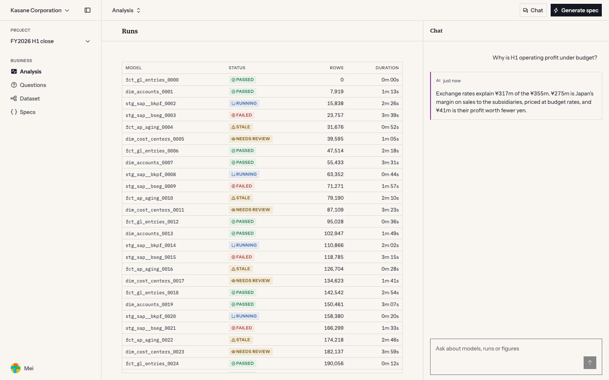
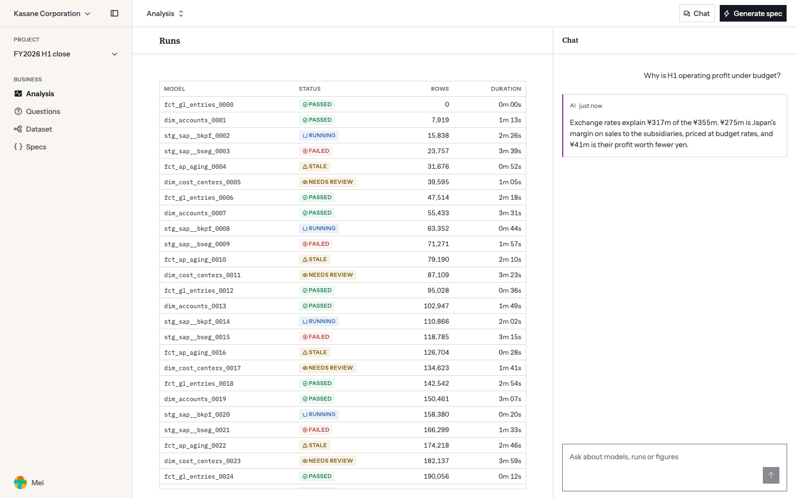
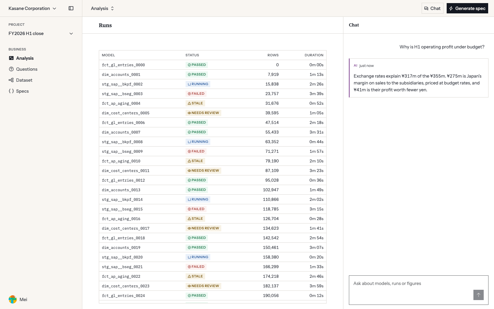
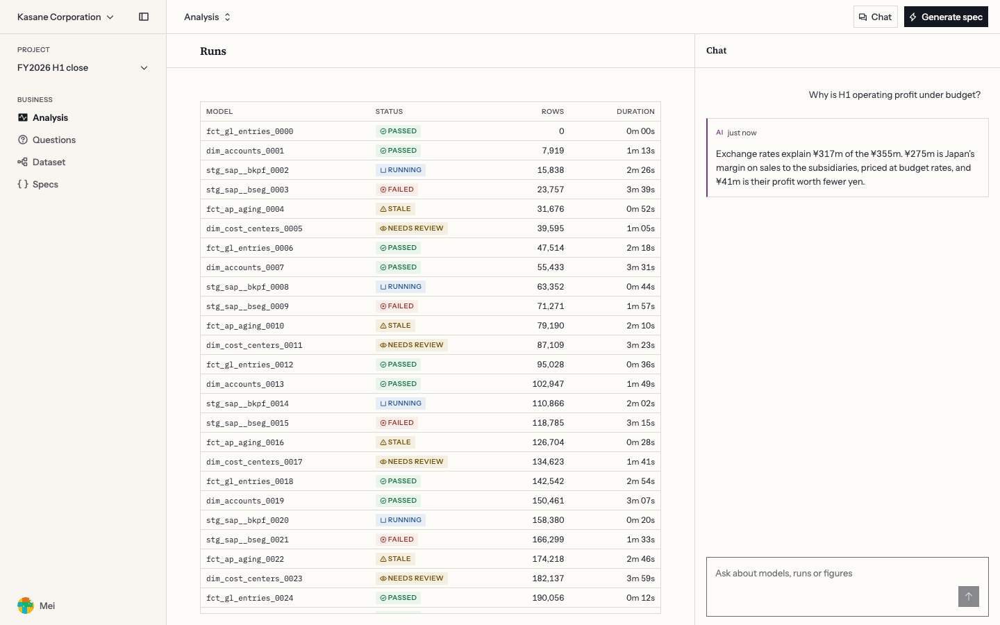
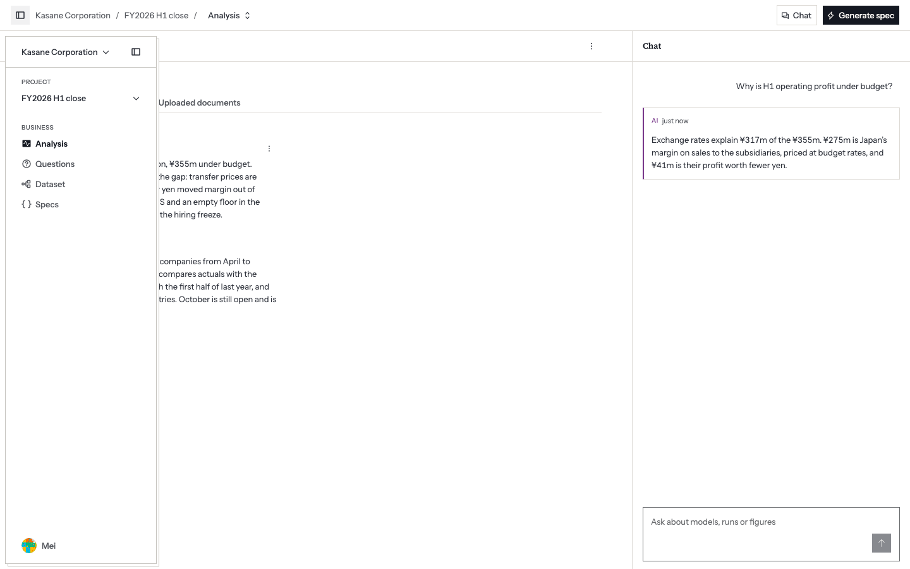
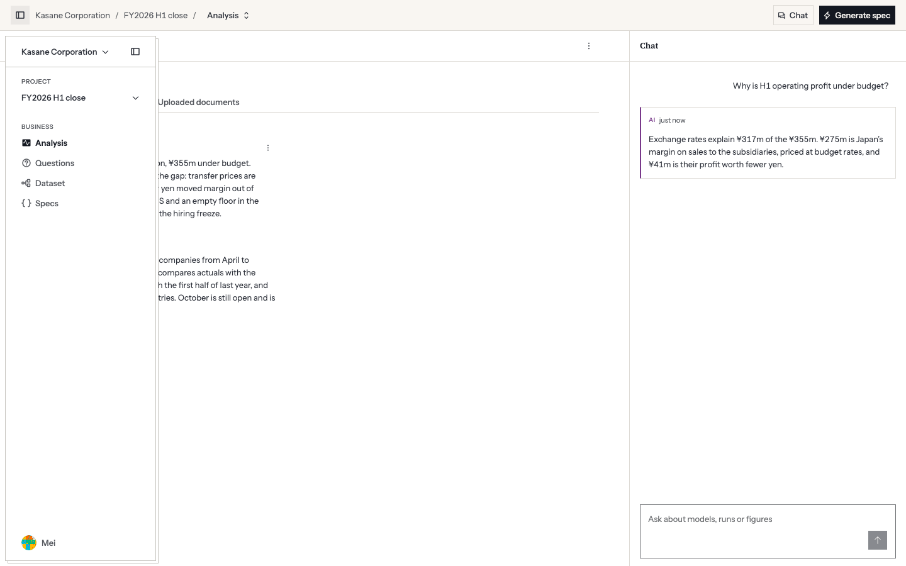

# White content, paper frame: proposal, 2026-11-12

**Status, 2026-11-12:** the owner chose option D from the Storybook side-by-side, which settles decisions 1 to 4: the page is white, in the warm white, the sidebar takes a new token on the paper, and the top nav is part of the page. Applied: `ledger-25` from the generator, `docs/design-system.md` §3 "The page and the frame" and §4, the three light grounds and `--color-surface-sunken` in `theme.css`, `AppShell`'s pinned sidebar, and the gates in `check-contrast.mjs`, `contrast.spec.ts` and `app-shell.spec.ts`. Decision 5 fell away with the choice: on the warm white the info tint at 8% is still grey, so 12% stays. **Decision 6, the site, is open**, and two of the site's tests fail until it is taken: its paper tile is baked on `ledger-50` and the page ground is now `ledger-25`. The text below is the proposal as written, and its renders were made by overriding tokens in Storybook.

The owner's opinion, which started this: the sidebar, with its header and footer, keeps the cream paper, and Main and Panel go white. I was asked to prove it wrong and could not. This is the proposal that follows, with what it reverses and what it costs.

**Asked of the owner:** four decisions, and two more that can wait.

1. **In light mode, canvas, surface and raised become white.** This reverses "Paper on paper" (§3, 2026-10-16). Recommended.
2. **Which white: `oklch(100% 0 0)` or a warm near-white, `oklch(99% 0.003 85)`.** I recommend the first, and the side-by-side should decide (images B and D).
3. **Add one token, `--color-surface-sunken`,** for the pinned sidebar: paper in light, the canvas in dark. Recommended.
4. **The top nav: white, or cream with the sidebar.** I recommend white (images B and C).

Separable, and not needed to ship the above:

5. The light info tint returns from 12% to 8%.
6. What the public site's panels do.

## What this touches

Listed first, as the failure log asks of any token proposal.

| Where | What it says today | Effect |
|---|---|---|
| `CLAUDE.md`, "You must ask before: adding a new token of any kind" | | Decision 3 is the ask |
| `CLAUDE.md`, "Never hand-type a colour value" | Every colour comes from `generate-palette.mjs` | The white is a new `ledger` step from the generator, `ledger-0`. `check-contrast.mjs` fails on any other form |
| §3, "Paper on paper — decided 2026-10-16" | Canvas, surface and raised are all `ledger-50`. A card separates "by its border, not by a white fill" | Reversed for the three grounds. Cards and popups still separate by border alone: white on white |
| §3, light table | One column of ratios, on paper | Every figure rises about 8%. A second column, on paper, for what sits in the sidebar |
| §3 and §4, "No `#fff` remains in the theme" | | No longer true of grounds. Still true of text on fills: `--color-on-*` stays `ledger-50` |
| §3, archive | Until 2026-10-16: `olive-50` canvas with `#fff` surfaces, two columns of ratios | This is close to that arrangement, with the roles swapped: then the page was tinted and cards white, now the frame is tinted and the page white |
| §4, "Ratios are against the paper canvas, `ledger-50`, not `#fff`" | | Rewritten: content ratios on white, sidebar ratios on paper. Paper is the lower column, so it is the one to design against wherever a component can sit in both |
| §4, "Light info tint is 12%, not 8% — decided 2026-11-06" | 8% read grey on the cream | The reason goes away on white (decision 5) |
| §4, elevation, "Three tiers" | Inline panel, raised, overlay. In light all three are the canvas | A fourth, below the page: sunken. Light only. Dark has no step under `ledger-950` |
| §4, the overlay sheet | "In light it is paper on paper and does not show; the rule alone draws it" | Unchanged in effect: white on white |
| §0 rule 1, "Color means state, never hierarchy" | | Checked. Both grounds are `ledger`, the neutral. No hue is involved |
| §0 rule 4, "Dark and light are not mirrors" | | Checked. This is light only, and dark does not change |
| §0 rule 7, "Borders do the work whitespace does" | | Unchanged. White against paper is 1.08:1, so every rule stays (see "What it does not do") |
| §0 rule 8, "`ledger-950` as canvas, never `#000`" | Pure black with light text is 21:1 and causes halation | Ink on white is 17.73:1, against 16.45:1 today. Not checked over a long session |
| `apps/storybook/tests/contrast.spec.ts:92` | Fails if the canvas ever equals white | Fails by design. Rewritten to pin the two grounds |
| `packages/ui/scripts/check-contrast.mjs` | Grounds: canvas, surface, raised and the row states over canvas | Adds the sunken ground and a hovered row over it, where the sidebar's nav sits |
| `docs/site.md` D3 item 4, and #170 | Every bordered panel on the site states `bg-canvas`, so the bond paper is never behind data | Those panels become white sheets on the paper unless the site says otherwise (decision 6) |
| Screenshot baselines, the demo's `og.png` | | Every light-mode picture changes |

No hue is added. No existing token is renamed. Three existing tokens change value in light mode. Dark mode is untouched.

## The case for it

**The frame recedes and the content comes forward.** In a flat system, lighter reads as closer and darker as further (Refactoring UI, "Even flat designs can have depth"). Today the sidebar, the page and the chat sit at one depth and three 1px rules do all the work. A background is also the strongest grouping cue there is (the law of common region), and a tinted sidebar beside white content is what people meet in most tools they use.

**Everything people read gets more contrast.** White adds about 8% to every ratio. The tightest pair in light mode, success text on its own tint over a selected, hovered row, goes from 4.73:1 to 5.08:1.

**Role tints sit closer to their own hue.** The cream is a 85° yellow at chroma 0.006, and every tint is composited over it. The info tint is the clear case: at 12% it has chroma 0.0092 on paper and 0.0142 on white.

**Hover and selection do not move.** The overlays are alpha, so they measure the same against either ground: 1.13:1 and 1.09:1.

## Measured

WCAG 2.1 contrast, from the values in `palette.css`, tints composited in sRGB and rounded to 8 bits per channel, as `check-contrast.mjs` does. Its second decimal can differ from §3's by 0.04 (ink on paper is 16.45 here, 16.49 there). "Worst" is the role's text on its own tint over a selected, hovered row.

**Neutral tokens.**

| Token | Step | Paper, today | White | Warm white |
|---|---|---|---|---|
| The ground itself, against paper | | 1.00 | 1.08 | 1.05 |
| `--color-text-primary` | `ledger-950` | 16.45 | 17.73 | 17.28 |
| `--color-text-body` | `ledger-900` | 12.44 | 13.40 | 13.06 |
| `--color-text-secondary` | `ledger-700` | 6.62 | 7.13 | 6.95 |
| `--color-text-tertiary`, `--color-border-control` | `ledger-600` | 4.90 | 5.28 | 5.15 |
| The same, on a selected, hovered row | | 3.98 | 4.31 | 4.20 |
| `--color-border` | `ledger-200` | 1.29 | 1.39 | 1.36 |
| `--color-border-strong` | `ledger-300` | 1.62 | 1.75 | 1.70 |
| `--color-ring` | `ledger-800` | 9.11 | 9.81 | 9.56 |
| `--color-fill-warning`, the fill's own edge | `ochre-500` | 3.37 | 3.63 | 3.54 |
| Hovered row against the ground | 6% ink | 1.13 | 1.13 | 1.13 |
| Selected row against the ground | 8% `ivy-500` | 1.09 | 1.09 | 1.09 |

**Role text, step 700.**

| Role | Paper | Paper, worst | White | White, worst | Warm white, worst |
|---|---|---|---|---|---|
| danger | 7.16 | 5.35 | 7.71 | 5.76 | 5.60 |
| warning | 6.71 | 4.98 | 7.23 | 5.35 | 5.21 |
| success | 6.26 | 4.73 | 6.74 | 5.08 | 4.94 |
| agent | 7.13 | 5.37 | 7.68 | 5.77 | 5.62 |
| info | 6.68 | 4.86 | 7.20 | 5.24 | 5.10 |

**The info tint**, for decision 5. §4 set 0.008 as the least chroma that does not read grey.

| `lake-500` at | Chroma on paper | Chroma on white | Chroma on warm white | Tint against white | Info text, worst, on white |
|---|---|---|---|---|---|
| 8% | 0.0046 | 0.0103 | 0.0059 | 1.09 | 5.44 |
| 10% | 0.0063 | 0.0125 | 0.0091 | 1.12 | 5.35 |
| 12%, today | 0.0092 | 0.0142 | 0.0114 | 1.14 | 5.24 |

## Images

`AppShell`'s `WithTable` and `Collapsed` stories at 1440 × 900, light mode.

| | |
|---|---|
| A. Today |  |
| B. White content, cream sidebar |  |
| C. The same, with a cream top nav |  |
| D. As B, in the warm white |  |
| Peek, under B |  |
| Peek, under C |  |

**The side-by-side was a Storybook story, under Reviews / White content 2026-11-12:** the four at half size on one page, each at full size with its popups on the same ground, and B and C with the sidebar collapsed. The owner decided from it, and it was deleted with the change, as a review story is. It was never merged, so it has no baselines.

A screenshot is not a monitor. The step between the two grounds is 1.08:1, and how it reads depends on the panel it is shown on.

## Why it cannot be scoped to `AppShell`

The request names two regions, and the first render set white on those two alone. That is not a design that can ship.

`Select`, `Menu`, `Popover`, `Combobox` and `Dialog` render through a portal, outside Main, on `--color-surface-raised`. With white scoped to Main, a menu opened from a white table is cream: a raised layer darker than what it covers, which reads as a hole. So the raised token has to be white for the whole document.

The surface token follows for the same reason in the other direction. `AppBar`, `MetricTile`, `Toolbar`, `CodeView` and `DataTable`'s totals row state `bg-surface`, and `DataTable` itself, the user's chat bubble and the demo's sticky composers state `bg-canvas`. Any of the three left on paper would paint a cream patch inside the white page. So all three go white, and the sidebar becomes the exception.

## The decisions

### 1. Canvas, surface and raised become white in light mode

```css
/* light */
--tui-canvas: var(--color-ledger-0);
--tui-surface: var(--color-ledger-0);
--tui-surface-raised: var(--color-ledger-0);
```

Nothing changes in a component for this. Dark mode keeps `ledger-950` and `ledger-925`.

### 2. Which white

| | `oklch(100% 0 0)` | `oklch(99% 0.003 85)` |
|---|---|---|
| Step from the paper | 1.08:1 | 1.05:1 |
| Gain on the tightest pair | 4.73 to 5.08 | 4.73 to 4.94 |
| Info tint at 8% | 0.0103, clears the floor | 0.0059, still grey, so the 12% exception stays |
| Temperature | No hue. May read cool beside the cream | The paper's hue, at half its chroma |

I recommend the first. The warm white gives back about four-tenths of the contrast gain and a third of an already small step, and it keeps the info exception. Against it: Refactoring UI asks that greys hold one temperature along the ramp, and a hueless white beside a warm cream is the one place this ramp would not. I did not see a cool cast in the renders, but that is a judgement on a screenshot. Images B and D are the pair to compare.

Either way it is one new step at the light end of `ledger`, written by `generate-palette.mjs`, as 925 was at the dark end. Refactoring UI's own rule for a grey ramp is that it runs "to white".

### 3. `--color-surface-sunken`

| Mode | Value | |
|---|---|---|
| Light | `ledger-50` | The paper. 1.08:1 under the page |
| Dark | `ledger-950` | The canvas. Nothing changes |

The name follows `--color-surface-raised`: the same property, the opposite direction. In dark it equals the canvas, as `--color-surface` already does, so this is not the failure log's "token that duplicates another": it differs in the mode where the distinction exists.

One class changes in `AppShell`, a product component: the pinned sidebar's `bg-surface` becomes `bg-surface-sunken` ([index.tsx:486](../../packages/ui/src/components/product/AppShell/index.tsx)). The sidebar also redefines `--tui-canvas` and `--tui-surface` for its subtree to the sunken value, so anything dropped into it that states a ground does not paint a white patch. This is the override the peek already makes for `--tui-border`, on the `--tui-*` layer as the failure log requires.

The peek needs nothing. It is `bg-surface-raised` today, so it becomes a white sheet over the white page, drawn by its strong border and the overlay sheet, as a `Dialog` is.

Without a new token the alternative is to keep the canvas on paper, move the page to `--color-surface`, and move every `bg-canvas` inside a page to `bg-surface`: 26 uses here, and an unknown number in apps that took the components through the registry, each of which would show as a cream patch with no error. I do not recommend it.

### 4. The top nav

- **White (B).** The frame is the sidebar and nothing else, which is what was asked. `AppBar` stays `bg-surface` and needs no change. The top nav holds the breadcrumb and the page's primary action, so it groups with the page under it. With the sidebar collapsed the app is white edge to edge, and the paper is gone from the screen.
- **Cream (C).** Sidebar and top nav read as one L-shaped frame, and a collapsed app keeps a 49px band of paper. It costs an override on the shell's top-nav wrapper, and the page's primary action then sits on the receded ground.

I recommend white. If the paper's disappearance when collapsed is the larger concern, C is the answer to it.

### 5. Separable: the info tint returns to 8%

On white, `lake-500` at 8% has chroma 0.0103, over the 0.008 floor that 12% was chosen to clear. At 8% it sits 1.09:1 from the ground, the same as the other roles, so a running row stops being the strongest tinted row and `check-harmony.mjs` loses its flag. Info text at worst rises to 5.44:1.

It holds only under the hueless white. And a `StatusBadge` with the info tone inside the sidebar would sit on paper, where 8% is 0.0046 again. I have not looked for one. This can follow the main change or not happen.

### 6. Separable: the public site

The site's body is the bond paper tile, drawn on `ledger-50` read from the palette, so the page itself does not move. Its bordered panels state `bg-canvas`, and #170 decided the same day as this proposal that they "stay flat" on the paper. Under decision 1 they become white sheets on it. That may be right, and it is the opposite of what was just chosen. The site can keep its panels on paper with one override of `--tui-canvas` at its root. I have not rendered the site either way.

## What it does not do

- **It removes no border.** 1.08:1 is well under anything that separates two regions alone, and under the 3:1 a boundary needs if it is the only cue. Every rule in the shell stays, by §0 rule 7. The gain is contrast and tint, and a quiet difference in depth.
- **It does nothing in dark mode,** the canonical one. There is no step under `ledger-950`.

## What it costs

- **A dated decision is reversed after 27 days.** "Paper on paper" gave light mode one ground and one column of ratios. This gives it two of each.
- **The paper covers 240 of 1440px with the sidebar pinned,** and none of the screen with it collapsed under option B. The art direction is "warm paper and blue-black ink" (`docs/palette.md`); in the product's light mode the paper becomes the frame's colour, not the page's.
- **The page is about 8% brighter,** in luminance, across everything but the sidebar: 0.925 to 1.0.
- **A palette step, a token, a spec section in §3 and §4, two gates rewritten, and every light baseline re-shot.**
- **Apps that took the theme through the registry change in light mode on their next update,** with no change to their own code.

## Not checked

- On a monitor, by a person. Every image here is a Playwright screenshot.
- The site, in either state of decision 6.
- A long session on the white ground.
- Forced colours. No ground is a mark, so I expect no change.
- The 6% hover on a 28px row over white, by eye. It measures the same 1.13:1.
- Popups in a render. That they are on the raised token and in a portal is read from the code.
- Whether any component inside the sidebar states a ground today. None showed in the renders.
- `lint/palette.mjs` and `palette.spec.ts` against a step named `ledger-0`.

## If approved

In this order, as `theme.css`'s header requires: the spec first (§3 light table and its note, §4's elevation tiers and ratio columns), then the generator and `palette.css`, then `theme.css` by transcription with a header entry, then `AppShell` and its README, then `check-contrast.mjs` and `contrast.spec.ts`, then baselines and `og.png`.
